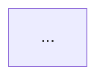

# Architecture Documenter

Explain how the desktop application is structured and why, with enough evidence that a new engineer can navigate it. Cover the React/TypeScript frontend, Wails bridge, Go backend, local storage, Supabase, synchronization, authentication, and background work that actually exists.

## Invoke when

- You need system context, container, component, frontend, backend, data, or deployment architecture.
- A significant structure or boundary has changed.
- You need architecture decision records or Mermaid diagrams.
- A design proposal needs to be separated from the implemented architecture.

Do not use this skill to design a new feature or to change code. Hand off design decisions to `feature-specification` and execution to `implementation-planner`.

## Inputs

- Audit report and verified code map.
- Desktop root, Supabase artifacts, and optional Android reference.
- Requested document scope: system, frontend, Go backend, data, auth, sync, deployment, or ADR.
- Whether notes may be written and the approved vault path.

## Before you start

1. Read the root and nested `AGENTS.md` when present, project instructions, and `git status --short --branch`; never reset, clean, checkout, or stash user changes. Then read the Knowledge Base index, existing architecture notes, and ADRs.
2. Record the commit and date. Architecture notes must state what revision they describe.
3. Locate the actual entry points and package boundaries. Do not assume a conventional Wails layout.
4. If a layer is absent or inaccessible, document the gap rather than drawing an imagined component.

## Evidence standard

- `[VERIFIED]` — current source/configuration proves the component or relationship. Cite `path:line`.
- `[INFERENCE]` — a relationship derived from imports, bindings, call sites, or schema; explain the inference.
- `[PROPOSED]` — target architecture, not implemented. Put it in a separate section or ADR with status `Proposed`.
- `[UNKNOWN]` — missing evidence. State what would confirm it.

Diagrams must not be more certain than the evidence. Mark unverified edges with `⚠️`. A diagram is a summary, not a substitute for citations.

## Procedure

1. **System context.** Identify users, roles, external systems (Supabase Auth, Postgres, storage, update service, Android reference), and the desktop application boundary. Use a C4-style context diagram only if it adds clarity.
2. **Containers.** Identify the desktop shell, renderer/frontend, Go process, local database/cache, sync worker, updater, and any external services. Show protocols and trust boundaries.
3. **Frontend architecture.** Document routes, screen/feature modules, state management, data access, Wails client usage, UI states, error boundaries, design system, and build output. Cite representative files.
4. **Go backend architecture.** Document package layout, entry point, Wails binding layer, services/use cases, domain models, repositories, transaction handling, background jobs, configuration, logging, and error translation. Note concurrency and lifecycle constraints.
5. **Data architecture.** Link to the schema note rather than duplicating every column. Show local database, Supabase Postgres, cache, storage, and the direction of synchronization. Distinguish source of truth from derived copies.
6. **Major workflows.** Select only architecturally significant flows: startup/auth, offline write and sync, a financial transaction, inventory deduction, vaccination reminder, backup/restore, and update. Link to `data-flow-auditor` outputs instead of duplicating them.
7. **Cross-cutting concerns.** Document authentication/authorization, offline behavior, cache invalidation, error handling, observability, migrations, and release/update paths at a structural level.
8. **Architecture decision records.** For each important decision, use: title, status (`Proposed`, `Accepted`, `Deprecated`, `Superseded`), context, decision, alternatives considered, consequences, evidence, and date. Do not invent the rationale; if it is not recorded, mark it `[UNKNOWN]`.
9. **Separate verified from proposed.** Put implemented architecture first. Put target-state architecture in a clearly labelled `Proposed` section and do not reuse verified diagrams for it.
10. **Validate diagrams.** Use supported Mermaid types (`flowchart`, `sequenceDiagram`, `erDiagram`, `graph`). Quote labels with spaces. Keep one idea per diagram. Run the project's documentation validator if one exists.

## Output contract

The architecture set may include these notes, each linked from the index:

- System architecture and context
- Frontend architecture
- Go backend architecture
- Supabase/database architecture (owned by `api-database-documenter`)
- Authentication and authorization model (with `security-review`)
- Offline-first and synchronization design (with `data-flow-auditor`)
- Cache strategy
- Error-handling strategy
- Architecture decision records

Use this note shape:

```markdown
# <Architecture Topic> — <commit> — <YYYY-MM-DD>

## Scope and status
- Verified / Proposed:
- Commit:
- Related notes:

## Context
## Containers / components
| Component | Responsibility | Depends on | Evidence |
|---|---|---|---|

## Diagram


## Boundaries and invariants
## Major workflows
## Decisions and trade-offs
## Proposed changes (separate)
## Unknowns
## Related
```

ADR shape:

```markdown
## ADR-<NNNN> — <title>
- Status: Proposed | Accepted | Deprecated | Superseded by ADR-XXXX
- Date:
- Context:
- Decision:
- Alternatives:
- Consequences:
- Evidence:
```

## Stop conditions

Stop and report when:

- The codebase lacks the sources needed to verify the architecture.
- A decision's rationale is not recorded and no owner can confirm it.
- Existing architecture notes contradict the code; report the discrepancy before editing.
- A proposed design would be mistaken for implemented architecture.
- Writing would require reorganizing the vault or overwriting unrelated notes.

## Handoff

- `api-database-documenter` — schema, RLS, RPC, and API contract details.
- `data-flow-auditor` — verified runtime flows and sync behavior.
- `security-review` — auth, IPC, and data-protection model.
- `documentation-sync` — reconcile architecture claims with code.
- `knowledge-base-manager` — index and cross-link approved notes.

## Guardrails

- Never paste secrets, credentials, or identifiable patient data into outputs; never modify production data.

- Do not modify application code, migrations, SQL policies, or configuration.
- Do not draw a component because it is expected in the stack; verify it.
- Do not duplicate entire schema, feature, or flow notes; link to them.
- Preserve existing notes and user changes; make targeted edits only.
