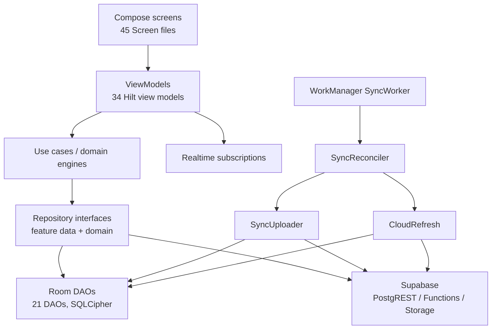

# Android Reference Architecture

> **This is a current-state reference, not a desktop design.** The Android repository is clean at `main` @ `ca4bed406bfd246ad83878fff9a4e178ebc5670f`. The desktop must reproduce business meaning and failure handling, not copy Android's screen structure or its unresolved debt.

## Verified snapshot

| Item | Value | Evidence |
|---|---|---|
| Application | Neo Child Clinic Android `0.5.1`, `versionCode` 3 | `gradle/libs.versions.toml` |
| Language/UI | Kotlin, Jetpack Compose, Navigation Compose | `app/build.gradle.kts`, source tree |
| SDK levels | `compileSdk 37`, `minSdk 29`, `targetSdk 35` | `app/build.gradle.kts` |
| Main Kotlin files | 352 | `find app/src/main/java -name '*.kt'` |
| Composed destinations | 51 `composable(...)` registrations | `app/` navigation graph |
| Screens / ViewModels | 45 `*Screen.kt`; 34 `*ViewModel.kt` (all `@HiltViewModel`) | source counts |
| Feature packages | 21 under `feature/` | source tree |
| Local database | Room version 33; 25 `@Entity` classes across 21 entity files; 21 DAOs | `data/local/database/AppDatabase.kt`, `data/local/` |
| SQL migrations | 23 under `supabase/migrations/` | repository |
| Tests | 41 unit files, 8 instrumented files | `app/src/test`, `app/src/androidTest` |
| Android Knowledge Base | 37 notes | `docs/Knowledge_Base/` |
| Git state | clean; no Android change made by this documentation pass | `git status` |

## Runtime stack

| Concern | Reference implementation | Notes for desktop |
|---|---|---|
| Dependency injection | Hilt modules under `core/di/` | Desktop has no DI choice yet; Do not copy Android annotations. |
| Auth | Supabase Auth via supabase-kt; session in encrypted storage | Keep tokens out of renderer/local logs. |
| API | PostgREST through supabase-kt | Desktop Go core should own HTTP and token use. |
| Realtime | supabase-kt Realtime; debounced refresh subscriptions | Realtime is an optimisation, not the source of truth. |
| Functions | `manage-staff`, `notify-update` invoked through Functions | Desktop must not bypass server-side authorization. |
| Storage | `patient-docs` bucket used for patient documents | Bucket privacy/policies remain unverified. |
| Local cache | Room + SQLCipher | Desktop is expected to use SQLite; encryption/backup design is not approved. |
| Background work | WorkManager `SyncWorker` | Desktop needs an equivalent durable scheduler. |
| Serialization | kotlinx.serialization | Contract types must remain explicit at the Wails boundary. |
| Observability | Android logger with redaction rules | No desktop logging/telemetry design exists. |

## Layer and package map

`feature/` is feature-first: each package typically has `data`, `domain`, and `presentation`. `domain/model/` holds pure Kotlin models. `data/local/` holds Room entities/DAOs. `core/` holds cross-cutting cache, DI, logging, network, notification, preferences, security, sync, and UI utilities.

The desktop architecture is intentionally different: a trusted Go core, Wails bindings, React renderer, and a local working database. See [System Architecture](System-Architecture.md) and [ADR-0001](../Decisions/ADR-0001-Desktop-Stack.md). The Android layer map is evidence of the domain seams, not a template for the desktop process boundary.

## Local persistence and encryption

`AppDatabase.kt` declares Room version 33, registers explicit migrations from 17 to 33, and opens the database through SQLCipher (`SupportOpenHelperFactory`). `SecurityUtils.getDatabasePassphrase()` stores the database passphrase in `EncryptedSharedPreferences` backed by an Android Keystore `MasterKey` (AES-256-GCM / AES-256-SIV schemes).

Verified consequences:

- A missing Keystore key is a hard failure; the app raises a user-facing “unlock device” error rather than silently opening plaintext.
- Migrations are explicit; there is no destructive fallback. A broken migration can strand local data.
- The local schema is not identical to the 24-table server schema: local-only tables include `inventory_deductions`, `sync_queue`, `backup_history`, and `widget_due_cache`; `doctor_weekly_slots` and `doctor_slot_exceptions` exist on both sides but have documented contract differences (see Phase 0C). The desktop local schema must be designed independently and reconciled with the shared server schema.
- Backup is a separate layer: `BackupCollector` reads business tables; `BackupCrypto` uses password-based AES-256-GCM; `BackupValidator`/`BackupRestorer` validate and restore; `SafetyBackupStore` keeps a pre-restore snapshot. `sync_queue` and the FCM token are excluded from the backup payload.

These are reference behaviours, not approved desktop decisions. See [Privacy and Backup](../Security/Privacy-and-Backup.md) and [ADR-0010](../Decisions/ADR-0010-Backup-and-Restore.md).

## Authentication and authorization

- `CurrentUserProvider` reads the role from Supabase `app_metadata.role`.
- A missing or malformed role returns no role rather than defaulting to a privileged role.
- UI gates exist for staff management, statistics, and patient edit/delete, but UI gates are not authorization.
- The shared backend's exported policies and grants do not match a safe target model. The reported `get_my_role()` fallback to `'nurse'` and legacy `{public}` policies are described in the [Security Model](../Security/Security-Model.md) and [Phase 0C review](../Audits/Phase-0C-Schema-Export-Review.md).
- Android's client-side role handling cannot compensate for an anon-reachable database path.

## Offline and sync

The reference uses an offline-first write path:

1. A user action is validated and written to Room business tables.
2. An outbox row is written to `sync_queue` with stable local identity.
3. The UI reports local success, not cloud success.
4. WorkManager (`SyncWorker`) and `SyncReconciler` push queued writes and pull remote changes.
5. Realtime subscriptions trigger a debounced refresh; they do not replace pull/reconcile.

Documented historical defects — duplicate stock retries, payment double-counting, stale dashboard refresh, N+1 patient refresh, and per-row sync scheduling — were fixed at `ca4bed4` or earlier according to the Android KB. They remain desktop regression targets. The unresolved deletion contract is documented in [Offline and Sync Design](Offline-and-Sync-Design.md): there is no complete server tombstone feed, and `sync_queue` is transient rather than an authoritative audit/outbox history.

## UI and state patterns

- Compose + Navigation Compose, 51 destinations registered in a mostly flat graph.
- 34 Hilt ViewModels; 88 `collectAsState()` call sites at the snapshot. Many screens consume multiple flows directly, which makes loading/error states hard to compose consistently.
- Dashboard uses a deeply nested `combine` graph and a 500 ms Realtime debounce. It is functional but costly to reason about; desktop should use one explicit view-state reducer per screen.
- Android frequently reloads whole datasets after a mutation. Desktop should use targeted local invalidation and bounded queries where semantics allow it.

## Backup and recovery

The reference supports local export, local restore, password-based encryption, schema/version validation, relationship validation, a pre-restore safety snapshot, and optional cloud backup APIs. The desktop backup/restore design is not approved; the target decision is [ADR-0010](../Decisions/ADR-0010-Backup-and-Restore.md), and the feature contract is [Backup and Recovery](../Features/18-Backup-and-Recovery.md).

## Testing evidence

The repository contains 41 unit test files and 8 instrumented test files. The existing Android KB records `./gradlew :app:testDebugUnitTest` with 277 passing unit tests and a green instrumented run on 2026-10-18. **Neither result was re-run in this documentation pass.** The Android KB also reports that ViewModel coverage is absent and DAO coverage is partial; those are historical KB findings, not a fresh measurement.

The 277 figure must not be presented as a desktop test result. Desktop tests run: 0.

## What the desktop should reuse

- Domain concepts: patient identity, visit aggregate, vaccine/batch identity, reminders, finance/receipt rules, roles.
- Failure semantics: local commit before acknowledgement, idempotent retries, explicit conflict states, no silent last-write-wins.
- Validation boundaries: server-assigned receipt numbers, IST business dates, active-staff checks, soft-delete filtering.
- Evidence discipline: distinguish source, export, live verification, and inference.

## What the desktop should not copy

- Android's production data-access shape or ViewModel topology.
- Client-side authorization as the primary control.
- Whole-table refresh on every mutation.
- A per-row scheduler or unbounded queue chain.
- An implicit deletion contract.
- Unencrypted logs, notification previews containing PHI, or a renderer that can read auth tokens/local database handles.

## Evidence limits

- No Gradle build, lint, test, migration, or device run was performed in this pass.
- Counts are from the clean snapshot above and will drift with Android development.
- The metadata export describes reported backend state, not a runtime authorization test.
- The existing Android KB contains historical numbers that may not match current source; this page uses the current source counts where independently checked.

## Related

[[Home]] · [[Product/Repository-Inventory|Repository Inventory]] · [[Product/Feature-Inventory|Feature Inventory]] · [[Product/Android-Desktop-Parity|Android-Desktop Parity]] · [[Architecture/System-Architecture|System Architecture]] · [[Architecture/Offline-and-Sync-Design|Offline and Sync Design]] · [[Audits/Phase-0C-Schema-Export-Review|Phase 0C Schema Export Review]] · [[Audits/Performance-Review|Performance Review]] · [[Product/Business-Rules|Business Rules]]
