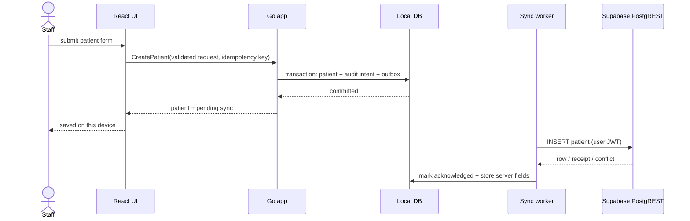
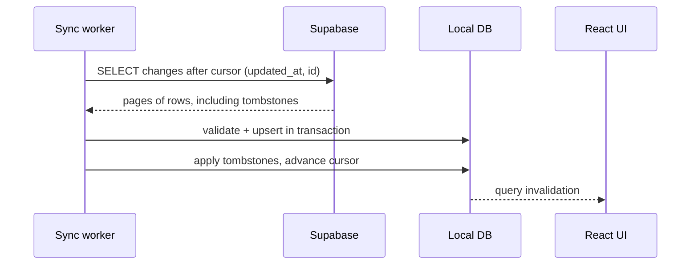
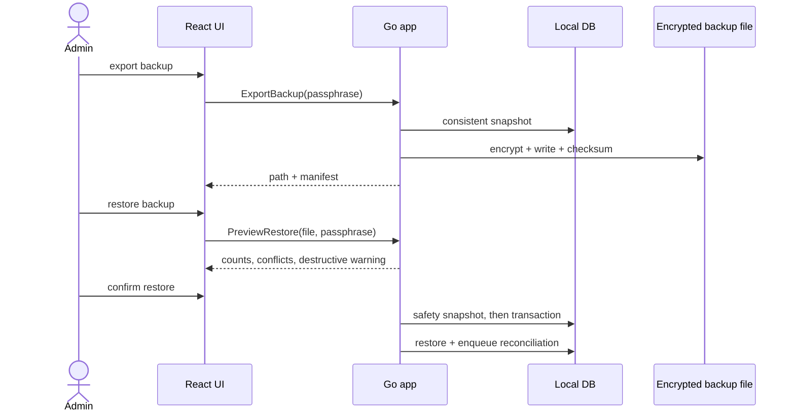

# Data Flows

> **Proposed desktop flows.** The Android reference implements analogous flows; the desktop does not exist. Each diagram names the intended durable writes and failure points. All remote steps target the **existing** Supabase project; see [[Decisions/ADR-0008-Shared-Supabase-Backend|ADR-0008]].

## 1. Sign-in and session restore

```mermaid
sequenceDiagram
    actor Staff
    participant UI as React UI
    participant Go as Go app
    participant Key as OS keychain
    participant Auth as Supabase Auth
    participant DB as Local DB

    Staff->>UI: email + password
    UI->>Go: Login(request)
    Go->>Auth: signInWithPassword
    Auth-->>Go: access + refresh token, app_metadata.role
    Go->>Key: store refresh token
    Go->>DB: open local profile/session metadata
    Go-->>UI: minimal session view + role
    UI-->>Staff: dashboard
    Note over Go,Auth: Expired token -> refresh; failure -> re-authenticate, never guess a role
```

Failure points: invalid credentials, disabled account, missing role claim, offline cold start with no cached session, revoked refresh token.

## 2. Patient registration while offline



The local commit is the user-visible success. "Synced" is a separate state. A retry uses the same patient ID and idempotency key.

## 3. Vaccination transaction

```mermaid
sequenceDiagram
    actor Nurse
    participant UI as React UI
    participant Go as Go app
    participant DB as Local DB
    participant PG as Supabase
    participant Sync as Sync worker

    Nurse->>UI: patient + vaccine + batch + dose + payment
    UI->>Go: CreateVaccination(request, idempotency key)
    Go->>Go: validate stock, expiry, batch, amounts, dates
    Go->>DB: BEGIN
    Go->>DB: visit + vaccination items + reminders + finance + stock movement + audit
    Go->>DB: outbox rows grouped by transaction_group_id
    Go->>DB: COMMIT
    Go-->>UI: committed + pending sync
    Sync->>PG: upload group in dependency order
    PG-->>Sync: assigned receipt number, stock result
    Sync->>DB: acknowledge group; surface conflict if any
```

The group must be atomic locally and idempotent remotely. A locally committed vaccination that fails to sync must remain visible and repairable; it must not be silently re-created with a new ID.

## 4. Pull and merge



Pull must be paged and resumable. A deleted row must remain deleted after a pull; an older remote row must not overwrite a newer local unacknowledged write.

## 5. Backup and restore



Restore is a destructive action. It requires a preview, a safety snapshot, a passphrase, and an explicit confirmation. A failed restore must leave the previous database intact.

## Data ownership

| Data | Local working copy | Shared authority | Notes |
|---|---|---|---|
| Session | Cached minimal state | Supabase Auth | Refresh token in OS keychain |
| Patient identity | Yes | PostgreSQL | UUID + human clinic ID |
| Clinical notes | Yes | PostgreSQL | PHI; encrypt at rest |
| Stock | Yes | PostgreSQL | Batch ledger; server trigger must be verified |
| Receipt number | Placeholder only | PostgreSQL sequence | Never computed locally |
| Audit | Append intent | PostgreSQL append-only | No client update/delete |
| Sync state | Yes | Local only | Outbox, cursor, errors |
| Settings | Yes | Mixed | Clinic policy vs device preference |

## Related

[[Architecture/Offline-and-Sync-Design|Offline and Sync Design]] · [[Architecture/Cache-Strategy|Cache Strategy]] · [[Database/Database-Architecture|Database Architecture]] · [[Features/17-Supabase-Sync|Supabase Sync]]
