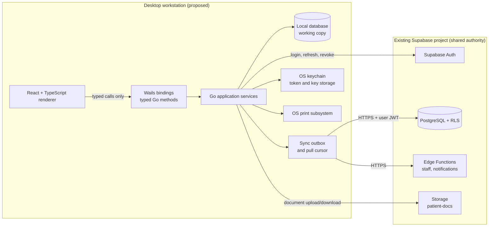
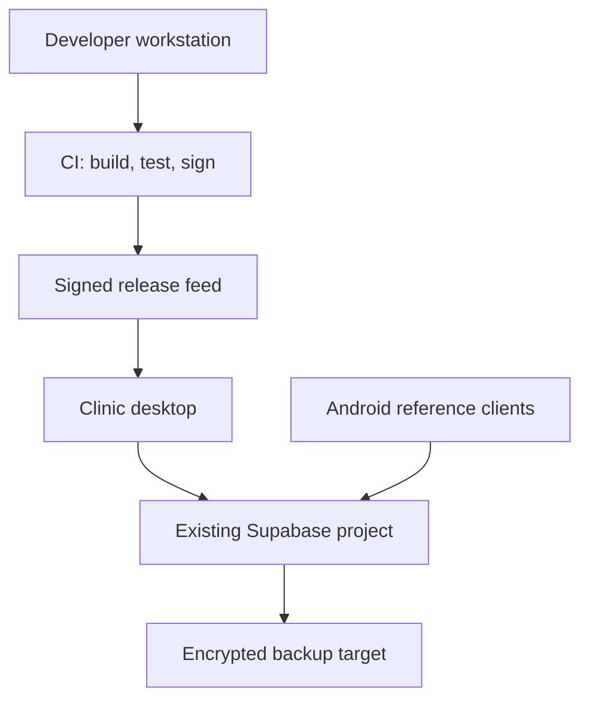

# System Architecture

> **This architecture is proposed.** No desktop process, database, binding, or sync worker exists yet. The diagram describes the target Phase 1 shape.

> **Accepted backend constraint `[DECISION]`:** Android and desktop must use the **same existing Supabase project**, PostgreSQL database, Auth users, Storage buckets, and Edge Functions. No new project, separate remote PostgreSQL database, parallel remote schema, or duplicate remote tables are approved. Local SQLite is a working copy, not a second backend. See [[Decisions/ADR-0008-Shared-Supabase-Backend|ADR-0008]] and [[Audits/Shared-Backend-Connection-Investigation|Shared Backend Investigation]].

## Context

The desktop client is one of several staff clients writing to the existing shared Supabase project. It must behave correctly when the network is unavailable and when another device changes the same record.

## Layers

| Layer | Responsibility | Must not do |
|---|---|---|
| Renderer (React/TS) | Presentation, form state, keyboard flows, accessible feedback | Hold refresh tokens, call Supabase directly, access the filesystem, invent authorization |
| Wails boundary | Typed request/response, cancellation, validation at the trust boundary, error mapping | Expose raw SQL, service-role credentials, or unrestricted file/network APIs |
| Application services (Go) | Use cases, transaction orchestration, permissions checks, audit intent, sync enqueue | Trust renderer input as authorized or validated |
| Domain (Go) | Pure business rules: money, dates, stock, due dates, merge rules | Depend on React, Wails, or database drivers |
| Infrastructure | Local DB, Supabase client, keychain, printing, update feed, logging | Contain business policy that cannot be tested in isolation |
| Sync worker | Outbox upload, pull cursor, retries, conflict resolution, approved deletion reconciliation | Mark a write acknowledged before the server confirms it |

## Runtime components

### Desktop shell
Single-instance window, signed-in gate, route guards, offline banner, sync center, update prompt, crash recovery. The shell must never show PHI in the OS window title or notification preview by default.

### Application service boundary
Every user action crosses a typed Wails method. The Go side validates shape, length, required fields, and authorization context before opening a transaction. The renderer never receives a database handle.

### Local working copy
The proposed local database is SQLite with WAL, foreign keys enabled, and a single writer. It stores the app's working set, an outbox, a pull cursor, sync metadata, and redacted operational logs. Local schema changes are versioned migrations, not ad-hoc `ALTER` at startup.

### Shared authority
The existing Supabase project issues staff sessions and hosts the shared PostgreSQL schema. PostgreSQL is the server-side source of truth and enforces RLS. Existing Edge Functions handle privileged account and notification operations using server-side secrets. The desktop client must use only the publishable/anon key plus a user JWT; it must not create a second remote PostgreSQL database, duplicate remote tables, or ship a service-role key. Local SQLite tables and migrations are expected.

## Trust boundaries

1. **Renderer to Go:** untrusted input. Validate everything; enforce authorization again in Go.
2. **Desktop to Supabase:** untrusted network. TLS, token expiry, retries, and conflict handling are mandatory.
3. **Supabase to local DB:** untrusted remote data. Validate types, strip unknown fields, and never let server data execute code.
4. **Local DB to OS:** PHI at rest. Use OS disk protection and an approved local encryption/key strategy.
5. **App to printer/export:** data egress. Require explicit user action, redact logs, and record export events.
6. **Update feed to executable:** supply-chain boundary. Signed artifacts, pinned versions, and rollback.

## Key architectural rules

- **One shared backend.** Both clients target the same existing project, remote schema, Auth users, Storage bucket, and functions. There is no desktop-only shared PostgreSQL database or duplicate remote table set; the local SQLite working copy is expected.
- **One business event, one identity.** Patient registration, visit creation, stock movement, payment, and receipt each get stable IDs before the first network call.
- **Transaction group.** A vaccination creates visit, items, stock movements, reminders, payment, and audit as one logical group. A partial remote apply must be detectable and repairable.
- **Server receipt numbers.** The receipt number is assigned by PostgreSQL, never generated by the desktop.
- **Server time is not business time.** The visit date is user-entered; `created_at`/`updated_at` are metadata. Reporting uses IST.
- **No last-write-wins on money or stock.** Those need idempotent, ordered operations and explicit conflict resolution.
- **Observable sync.** Pending, syncing, failed, conflicted, and acknowledged are distinct states.

## Deployment view

## Open questions

- Who supplies the approved existing-project configuration, and how is the same-project fingerprint verified without exposing secrets?
- What non-destructive verification path is approved for the existing project?
- Wails major version and supported OS matrix.
- Local database encryption approach and key recovery.
- Whether the desktop runs one instance per OS user or one shared kiosk account.
- Whether a local print service is in scope or the OS print dialog is sufficient.
- Multi-workstation conflict expectations for the same patient or batch.

## Related

[[Architecture/Frontend-Architecture|Frontend Architecture]] · [[Architecture/Go-Backend-Architecture|Go Backend Architecture]] · [[Architecture/Offline-and-Sync-Design|Offline and Sync Design]] · [[Database/Database-Architecture|Database Architecture]] · [[Security/Threat-Model|Threat Model]] · [[Decisions/ADR-0008-Shared-Supabase-Backend|ADR-0008]] · [[Audits/Shared-Backend-Connection-Investigation|Shared Backend Investigation]]
