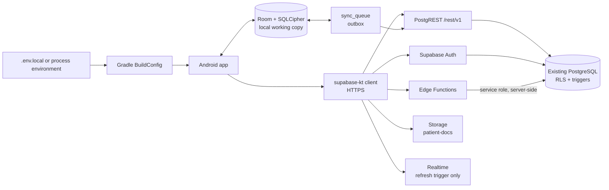
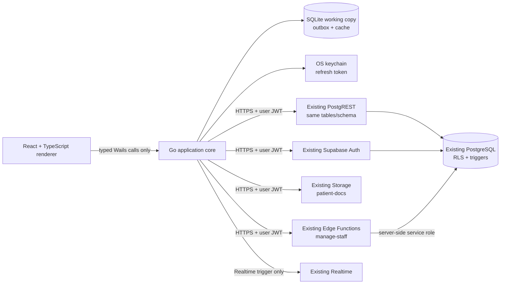

# Shared Backend Connection Investigation

> **Read-only investigation.** No application source, schema, migration, RLS policy, grant, trigger, database setting, or production data was changed. No credential value is reproduced in this note. Live Supabase access was not available.

**Pass date:** 2026-10-20
**Android reference:** `/data/data/com.termux/files/home/Neo_Child_Clinic` — `main` @ `ca4bed406bfd246ad83878fff9a4e178ebc5670f`, clean worktree
**Desktop project:** `/storage/emulated/0/Neo_Child_Clinic_Desktop` — not a Git repository
**Binding decision:** [[Decisions/ADR-0008-Shared-Supabase-Backend|ADR-0008 — Shared Supabase Backend and Single Schema]]
**Return to:** [[Home]]

## 1. CSV discovery and structure

Three candidate files were found. They contain schema metadata, not connection configuration.

| Candidate | SHA-256 | Size | Rows | Tables | Git status | Assessment |
|---|---|---:|---:|---:|---|---|
| Android repo: `supabase/migrations/Supabase Snippet Full Schema Catalog (Tables, Keys, Indexes).csv` | `7fc4208a4a464801930a3068d8036ceb889a6b6e87ae28e7264b124d44b68f22` | 19,581 B | 361 | 23 | Tracked; introduced in `f8e5d8a` | Older, stale snapshot. Its filename claims keys and indexes, but its columns contain only table/column metadata. |
| Shared-storage copy: `/storage/emulated/0/Neo_Child_Clinic-main/supabase/migrations/Supabase Snippet Full Schema Catalog (Tables, Keys, Indexes).csv` | `7fc4208a4a464801930a3068d8036ceb889a6b6e87ae28e7264b124d44b68f22` | 19,581 B | 361 | 23 | Not part of the inspected Android worktree | Byte-identical duplicate of the Android repo CSV; not independent evidence. |
| Desktop project: `/storage/emulated/0/Neo_Child_Clinic_Desktop/Supabase Snippet List Public Table Columns.csv` | `1e5ceee58a083c63ba1af024f9bc41d6f0809daefe28dce3e4507d9ee80c978a` | 23,237 B | 416 | 24 | Untracked; desktop project has no Git repository | Newer, broader snapshot, but still not a live-schema authority. |

Both CSVs use the same seven fields:

`table_name`, `column_order`, `column_name`, `data_type`, `postgres_type`, `is_nullable`, `column_default`

Neither CSV contains a project URL, project reference, authentication setting, grant, RLS policy, Storage/Realtime/RPC configuration, or credential field. A field-name and value-pattern scan found no `http(s)://` URL, JWT-like literal, `service_role` reference, publishable/secret key prefix, PostgreSQL URI, or password/secret field in either file. The values were not reproduced.

### Snapshot comparison

| Difference | Android repo CSV | Desktop CSV | Consequence |
|---|---|---|---|
| Tables | 23 | 24 | Desktop snapshot adds `api_write_rate_limits`, a server-side write-throttle table. |
| Columns | 361 | 416 | 55 more column rows in the newer snapshot, including soft-delete columns on many tables. |
| `waste_records` naming | camelCase: `vaccineId`, `batchId`, `brandName`, `batchNumber`, `expiryDate`, `dateWasted`, `updatedAt`, `isSynced` | snake_case: `vaccine_id`, `batch_id`, `brand_name`, `batch_number`, `expiry_date`, `date_wasted`, `updated_at`, `is_synced` | The Android CSV predates `20260919_waste_records_snake_case.sql`. Current `WasteEntity` uses `@SerialName` snake_case names and current queries filter `is_deleted`, so the older CSV would generate the wrong desktop contract. |
| Soft delete | Mostly absent | `is_deleted`, `deleted_at`, `deleted_by` on many tables | The current Android source filters `is_deleted` in most refresh paths. A desktop model generated from the old CSV would reject or omit current rows. |
| Ordinal completeness | Gaps exist | Gaps exist | Even the 416-column snapshot may omit columns. It is not proof of completeness. |
| `todo_notification_events` | Absent | Absent | Migration `20261016_rls_index_and_stock_trigger_hardening.sql` references this table as created by a migration not present in the repository. Its live status is unknown. |

**Conclusion:** the Android repo CSV is an older snapshot; the desktop CSV is newer but still incomplete and unverified. Neither is a connection configuration. The CSV must not be used to prove which Supabase project the Android app uses.

## 2. Android database connection architecture

### 2.1 End-to-end path

`[VERIFIED]` There is no direct JDBC/PostgreSQL connection in the Android app. All business-data access is HTTPS through the Supabase client, primarily PostgREST, with Auth, Functions, Storage, and Realtime installed on the same client.

### 2.2 Build-time configuration

`[VERIFIED]` `app/build.gradle.kts`:

- Lines 12–18 load `.env.local` into a `Properties` object if the file exists.
- Lines 20–22 resolve each key from `.env.local`, then the process environment, then a default.
- Line 46 sets `BuildConfig.SUPABASE_URL` from `getEnv("SUPABASE_URL", "")`.
- Line 47 sets `BuildConfig.SUPABASE_ANON_KEY` from `getEnv("SUPABASE_PUBLISHABLE_KEY", "")`.
- Line 51 sets optional `BuildConfig.BACKUP_WORKER_URL` from `getEnv("BACKUP_WORKER_URL")`. This is the Cloudflare backup worker, not Supabase.

`[VERIFIED]` The inspected worktree has no `.env.local`, `.env`, `local.properties`, or `secrets.properties`, and the three variables read by the build (`SUPABASE_URL`, `SUPABASE_PUBLISHABLE_KEY`, `BACKUP_WORKER_URL`) were unset in the inspection shell. `.env.local` is not tracked and has no Git history. Therefore the actual project URL, project reference, and publishable-key value were **not available** in this pass.

`[VERIFIED]` `supabase/config.toml` exists and contains a `project_id` field, but this is Supabase CLI configuration, not the Android runtime connection. Its value is not reproduced. Secret-named entries in this file (OpenAI, Twilio, Apple, S3) use `env(...)` references; no literal secret value was observed in those fields. The file is tracked, so future edits must not introduce literals.

`[VERIFIED]` No build-variant override of the Supabase URL/key was found. The `debug` and `release` build types change version naming and packaging behavior, not the Supabase endpoint. No product flavors were found.

`[UNKNOWN]` A previously built APK or generated `BuildConfig` could contain the runtime values, but build outputs and APKs were not inspected in this read-only pass. The actual hosted project identity therefore cannot be asserted.

### 2.3 Client initialization

`[VERIFIED]` `core/di/SupabaseModule.kt` provides one singleton `SupabaseClient`:

- Reads `BuildConfig.SUPABASE_URL` and `BuildConfig.SUPABASE_ANON_KEY` (lines 36–37).
- Calls `createSupabaseClient(supabaseUrl, supabaseKey)` (lines 44–47).
- Uses Ktor CIO and KotlinX JSON (lines 48–53).
- Installs `Postgrest`, `Auth`, `Functions`, `Realtime`, and `Storage` (lines 54–65).
- Configures `Auth` with `autoSaveToStorage = true` and `autoLoadFromStorage = true` (lines 55–61).
- Stores the session through `SettingsSessionManager` backed by `SecurityUtils.getSecurePrefs(context)`, not plaintext SharedPreferences (lines 42, 58–61).
- Migrates a legacy plaintext session into encrypted preferences and removes the plaintext copy (lines 69–83).

`[VERIFIED]` `SecurityUtils.kt` creates Android Keystore-backed `EncryptedSharedPreferences` with AES-256-GCM values and AES-256-SIV keys (`secure_prefs`), and stores the SQLCipher database passphrase in the same protected store (lines 14–70).

### 2.4 Authentication and session behavior

`[VERIFIED]` `core/security/AuthViewModel.kt`:

- `login(email, pass, onSuccess)` calls `auth.signInWith(Email)` (lines 200–216).
- It reads the user from `auth.currentSessionOrNull()?.user` (lines 57, 218).
- It waits for `auth.sessionStatus` to leave `Initializing`, with a 4-second bound so an offline cold start does not hang (lines 43, 59–82).
- It uses `auth.currentSessionOrNull()?.user?.id` as the authenticated identity (lines 130–137, 218, 348).
- On sign-out it flushes the outbox with a 20-second bound, blocks if unacknowledged rows remain, then best-effort deactivates the device, calls `auth.signOut()`, calls `auth.clearSession()` for offline safety, clears caches, and clears the Room database (lines 296–345).
- `refreshSessionStatus()` re-fetches the profile; the SDK owns token refresh (lines 347–352).

`[INFERRED]` `supabase-kt`'s default automatic refresh, combined with `autoLoadFromStorage`, refreshes an expiring stored session on cold start. The app does not implement its own refresh endpoint call.

`[VERIFIED]` Authorization role is read from the session's `app_metadata.role`, not `profiles.role` or `user_metadata`:

- `CurrentUserProvider.kt` maps `auth.currentSessionOrNull()?.user?.appMetadata` and returns `null` for missing/unknown roles (lines 22–36).
- `AuthViewModel` uses `CurrentUserProvider.getCurrentUserRole()` for authorization and uses the `profiles` row only for display/activation (lines 99–100, 147–190).
- `20261001_app_metadata_roles.sql` makes the same `auth.jwt() -> 'app_metadata' ->> 'role'` claim the RLS role source.

### 2.5 Data access

`[VERIFIED]` The Android source has 21 unique direct `postgrest.from("<table>")` targets. The sync registry adds `patient_notes` through a descriptor, and `user_devices` is accessed directly, giving 22 client-accessed public tables. The direct set is:

`audit_logs`, `borrow_records`, `borrow_returns`, `consultation_todos`, `consultations`, `doctor_slot_exceptions`, `doctor_weekly_slots`, `expenses`, `finance_transactions`, `inventory_transactions`, `patient_visits`, `patients`, `personal_vaccine_reminders`, `profiles`, `reminders`, `user_devices`, `vaccination_items`, `vaccination_todos`, `vaccine_batches`, `vaccines`, `waste_records`, plus `patient_notes` through the sync registry.

`[VERIFIED]` No `postgrest.rpc(...)` calls were found in Android source. Receipt numbers are assigned by PostgreSQL trigger/functions in `20260824_receipt_numbering.sql`; the client uploads a visit and reads the assigned `receipt_number` back.

`[VERIFIED]` The only Android-invoked Edge Function is `manage-staff`:

- `feature/staff/data/StaffManagementRepositoryImpl.kt:15–20` calls `functions.invoke("manage-staff", req)` for create and staff actions.
- `supabase/functions/manage-staff/index.ts` reads `SUPABASE_URL` and `SUPABASE_SERVICE_ROLE_KEY` server-side, authenticates the caller, checks `user.app_metadata.role == "admin"`, and checks the caller's profile is active and not deleted (lines 18–41).
- `notify-update` exists server-side but is not invoked by Android source; its documented caller is the GitHub notification workflow. It also uses a server-side service-role key and a shared secret.

`[VERIFIED]` Supabase Storage is used for patient documents:

- `feature/patient/data/DocumentRepositoryImpl.kt:17` uses bucket `patient-docs`.
- Upload, list, signed URL, and delete are implemented at lines 19–37.
- `20261016_rls_index_and_stock_trigger_hardening.sql:67–76` creates the bucket as private and gives authenticated active staff access through `public.is_active_staff()`.

`[VERIFIED]` Realtime is used only as a refresh trigger:

- `core/sync/RealtimeChangeSubscriptions.kt:36–108` subscribes to Postgres changes and emits `Unit`.
- `PatientListViewModel` subscribes to `patients`, `patient_visits`, and `consultations` on channel `patients-db-changes`.
- `DashboardViewModel` subscribes to `consultation_todos` and `vaccination_todos` on channel `todays-patients-db-changes`.
- The surrounding source comments state Realtime never writes; the `sync_queue`/worker path remains the only push path.

### 2.6 Local database and sync

`[VERIFIED]` `data/local/database/AppDatabase.kt` defines Room version 33 with 25 entities, including local-only `sync_queue`, `widget_due_cache`, `inventory_deductions`, and `backup_history`. SQLCipher is configured through the Keystore-backed passphrase.

`[VERIFIED]` `SyncUploader.kt` is the central entity registry and upload path. It maps local entities to remote table names, performs conflict checks, and uses upsert/delete through PostgREST (registry around lines 57–357; upload around lines 430–590). `SyncReconciler.kt:41–72` runs outbound sync before inbound refresh when online and authenticated. Local reads are served from Room and do not wait for the network.

## 3. Exact source files responsible for the connection

All paths below are Android-repository-relative unless stated otherwise.

| Responsibility | File and symbol | What it proves |
|---|---|---|
| Build-time URL/key | `app/build.gradle.kts`, `getEnv`, `buildConfigField` lines 12–22 and 46–51 | `SUPABASE_URL` and `SUPABASE_ANON_KEY` (from `SUPABASE_PUBLISHABLE_KEY`) are build config, not source literals |
| Client construction | `app/src/main/java/com/neochildclinic/core/di/SupabaseModule.kt`, `provideSupabaseClient` lines 36–67 | Single supabase-kt client with Auth, PostgREST, Functions, Realtime, Storage |
| Session storage | `core/security/SecurityUtils.kt`, `getSecurePrefs` and `getDatabasePassphrase` lines 22–70 | Keystore-backed encrypted preferences; SQLCipher passphrase protection |
| Auth and sign-out | `core/security/AuthViewModel.kt`, `login`, `awaitResolvedSessionStatus`, `logout`, `completeSignOut` | Email/password sign-in, session restore, queue-safe sign-out, local data clearing |
| Role source | `core/security/CurrentUserProvider.kt`, `roleFromAppMetadata` and `SessionCurrentUserProvider` | Authorization role comes from `app_metadata.role`; missing role returns null |
| Identity helper | `core/security/SessionManager.kt` lines 19–50 | Current user ID/name from `auth.currentSessionOrNull()` |
| PostgREST access | `feature/*/data/*RepositoryImpl.kt`, `data/remote/PatientRemoteDataSourceImpl.kt`, `feature/auth/data/DeviceRepositoryImpl.kt` | Direct table reads/writes and filters; no direct PostgreSQL driver |
| Sync registry and push | `core/sync/SyncUploader.kt` | Remote table names, upserts, deletes, conflict checks |
| Sync trigger | `core/sync/SyncReconciler.kt` | Online + authenticated reconciliation; outbound before inbound |
| Realtime trigger | `core/sync/RealtimeChangeSubscriptions.kt` | Postgres change subscriptions; refresh-only behavior |
| Patient documents | `feature/patient/data/DocumentRepositoryImpl.kt` | `patient-docs` bucket access with the user session |
| Staff administration | `feature/staff/data/StaffManagementRepositoryImpl.kt`; `supabase/functions/manage-staff/index.ts` | Only invoked Edge Function; server-side service role |
| Update notifications | `supabase/functions/notify-update/index.ts` | Server-side FCM function; not called by Android source |
| RLS functions | `supabase/migrations/20260825_clinic_rls_and_accountability.sql`, `20260929000000_security_baseline.sql`, `20261001_app_metadata_roles.sql`, `20261013120000_role_policy_carveouts.sql` | Active-staff and admin policies; JWT role claim |
| Storage policy | `supabase/migrations/20261016_rls_index_and_stock_trigger_hardening.sql:67–76` | Private `patient-docs` bucket and active-staff policy |
| Receipt assignment | `supabase/migrations/20260824_receipt_numbering.sql` | Server-side receipt sequence and immutability trigger |
| Existing RLS checks | `supabase/tests/rls_role_test.sql`; `supabase/verify_security.sql` | Test intent and read-only verification queries; neither was run in this pass |

## 4. CSV-versus-source comparison

**Important:** the CSV has no connection fields, so it cannot establish a project URL or project match. "Unknown" below is the correct result, not a hidden mismatch.

| Item | CSV reference | Android source evidence | Result |
|---|---|---|---|
| Project URL | No URL field in either CSV | `BuildConfig.SUPABASE_URL` is injected from `.env.local` or environment by `app/build.gradle.kts:12–22,46`; the actual value is absent from the clean worktree and the environment inspected | **Unknown** — no value to compare; no live connection attempted |
| Supabase project | No project reference, project ID, or connection string in either CSV | `supabase/config.toml` has a CLI `project_id`, but it is not the Android runtime source; no remote section or hosted identity match was verified | **Unknown** — cannot prove the CSV and Android point at the same hosted project |
| Authentication | No auth provider, user, token, or setting in either CSV | `SupabaseModule` installs `Auth`; `AuthViewModel.login` uses email/password `signInWith(Email)`; session is encrypted and restored | **Verified in source; live behavior unknown** |
| Database access | 24 tables / 416 columns (desktop snapshot); 23 / 361 (Android repo snapshot); no keys, indexes, grants, or relationships | 22 client-accessed public tables through PostgREST; `SyncUploader` registry; no `.rpc`; 9 of 24 tables are created from zero in migrations | **Partially verified in source; live schema unknown** |
| RLS | No policies, roles, grants, or enforcement settings | `is_active_staff()` and `is_admin()` are defined in migrations; active-staff CRUD policies, role carve-outs, append-only audit, owner-scoped devices, private Storage policy | **Verified SQL intent; live enforcement untested** |
| Storage / RPC / Realtime | No bucket, function, RPC, or channel entries | Storage `patient-docs`; no RPC; Edge Function `manage-staff`; Realtime channels for patients/visits/consultations and todo tables; `notify-update` server-only | **Verified in source; live configuration unknown** |

## 5. Existing tables and access patterns verified from evidence

### 5.1 Server-side table set

The newer desktop CSV lists 24 public tables. The Android repository CSV lists 23. The live project may contain more; `todo_notification_events` is referenced by migration but absent from both CSVs.

| Group | Tables in the newer snapshot | Android access pattern |
|---|---|---|
| Identity/accountability | `profiles`, `user_devices`, `audit_logs`, `api_write_rate_limits` | Profiles read/update; devices read/write by owner; audit read/append; rate-limit table server-only |
| Patients | `patients`, `patient_notes`, `patient_visits` | PostgREST reads/writes; `patient_notes` through sync registry; visits drive vaccination/finance |
| Clinical | `consultations`, `consultation_todos`, `vaccination_items`, `vaccination_todos`, `reminders`, `personal_vaccine_reminders` | PostgREST/SyncUploader reads/writes; receipt assignment on visit insert |
| Inventory | `vaccines`, `vaccine_batches`, `inventory_transactions`, `waste_records`, `borrow_records`, `borrow_returns` | PostgREST reads/writes; server stock triggers; soft-delete filters |
| Finance | `finance_transactions`, `expenses`, `receipt_sequences` | PostgREST reads/writes; receipt sequence is server-only; admin/doctor expense update/delete |
| Scheduling | `doctor_weekly_slots`, `doctor_slot_exceptions` | Reads by authenticated users; writes by owning doctor or admin |
| Internal/unknown | `todo_notification_events` (referenced, not in CSV) | No client reads; SECURITY DEFINER trigger writer per migration comments |

### 5.2 Local-only tables

`[VERIFIED]` Room entities exist for `sync_queue`, `widget_due_cache`, `inventory_deductions`, and `backup_history`, but none of these is in either public-table CSV. They must remain local-only desktop tables; creating them remotely would be a parallel schema.

### 5.3 Schema reproducibility

`[VERIFIED]` Repository migrations create only nine of the 24 tables in the newer snapshot from zero:

`api_write_rate_limits`, `borrow_returns`, `consultation_todos`, `doctor_slot_exceptions`, `doctor_weekly_slots`, `expenses`, `personal_vaccine_reminders`, `receipt_sequences`, `vaccination_todos`.

The other tables are altered by migrations but assumed to pre-exist. There is no baseline migration. A clean database cannot be rebuilt from this repository alone, and a desktop schema generator must not pretend otherwise.

### 5.4 Query and write patterns that the desktop must preserve

- Patient reads filter `is_deleted = false` in current source; soft-delete columns are part of the newer snapshot.
- Vaccination sync uploads `patient_visits`, `vaccination_items`, and related inventory transactions through `SyncUploader`.
- `inventory_transactions` local primary key/column names differ from remote (`transactionId` vs remote `id`); `SyncUploader` handles this explicitly.
- Receipt numbers are server-assigned and immutable; the client must upload blank and read back.
- `audit_logs` is select + insert from the client; no update/delete.
- `profiles` lifecycle is admin-only through `manage-staff`, not direct client insert/delete.
- `patient-docs` is private Storage, authenticated active-staff-wide, not tenant-scoped.
- Realtime is a refresh trigger only; it is not an independent write channel.

## 6. Authentication and RLS findings

### 6.1 Authentication

`[VERIFIED]` Android uses Supabase Auth email/password, with the session stored in Keystore-backed encrypted preferences. The user identity is `auth.currentSessionOrNull()?.user?.id`; RLS uses `auth.uid()`.

`[VERIFIED]` Authorization role is `app_metadata.role`. `CurrentUserProvider` returns null for missing/unknown values and never defaults. `AuthViewModel` treats the `profiles` row as display/activation data, not as the authorization role. Staff creation/role changes go through the `manage-staff` Edge Function, which checks the caller's `app_metadata.role` and active/deleted status server-side.

`[VERIFIED]` `manage-staff` and `notify-update` use `SUPABASE_SERVICE_ROLE_KEY` only in server-side Edge Function code. No `service_role` string or literal Supabase URL/JWT was found in `app/src/main` source. This is the required pattern; the desktop must not copy the server-side key.

### 6.2 RLS

`[VERIFIED]` Repository migrations establish a single-clinic, active-staff model:

- `is_active_staff()` is a `SECURITY DEFINER` function checking `profiles.id = auth.uid()`, `is_active = true`, and `is_deleted = false`.
- Most clinical/business tables grant active staff select/insert/update/delete.
- `audit_logs` is select + insert only; no client update/delete policy.
- `expenses` update/delete is restricted to admin/doctor; insert remains active-staff.
- `doctor_weekly_slots` and `doctor_slot_exceptions` are readable by authenticated users and writable by the owning doctor or an admin.
- `profiles` is broadly readable by active staff; client self-update exists, but a trigger blocks privileged fields unless the actor is an admin; lifecycle operations are server-side.
- `user_devices` is owner-scoped; insert/update owner policies were removed to prevent a deactivated user re-enabling their own device.
- `receipt_sequences` and `api_write_rate_limits` are revoked from `anon`/`authenticated` and are server-only.
- `api_write_rate_limits` enforces 600 client writes per user per minute; service-role operations bypass it.
- `patient-docs` is private, with active-staff-wide object access.
- `is_admin()` checks active/non-deleted profile plus the JWT `app_metadata.role = 'admin'`.

`[UNKNOWN]` The live project may have legacy permissive policies, different grants, missing triggers, or a different schema. `supabase/tests/rls_role_test.sql` contains placeholder UUIDs and was not run. `supabase/verify_security.sql` is read-only and was not run. No claim is made that the SQL in the repository is deployed or effective.

## 7. Desktop connection implementation status

`[VERIFIED]` The desktop project contains only:

- `.opencode/skills/` definitions;
- `docs/Knowledge_Base/`;
- `Supabase Snippet List Public Table Columns.csv`.

`[VERIFIED]` It contains no:

- `go.mod`, `wails.json`, `package.json`, Go/TypeScript/React source;
- `.env` or `.env.local`;
- Supabase client, HTTP client, database driver, repositories, migrations, or local database;
- test suite, CI, build output, or Git repository.

**Status: Missing. No desktop connection exists, and there is nothing to inspect for URL, key, auth, RLS, Storage, RPC, or Realtime behavior.** The desktop has not been connected to the existing project, correctly or incorrectly.

## 8. Mismatches, missing configuration, and security concerns

| ID | Finding | Evidence | Impact | Required disposition |
|---|---|---|---|---|
| CONN-001 | Actual project URL/project identity and publishable key are absent from the worktree and inspection environment | `.env.local`, `.env`, `local.properties` absent; `SUPABASE_URL`, `SUPABASE_PUBLISHABLE_KEY`, and `BACKUP_WORKER_URL` unset; CSV has no connection fields | Cannot prove desktop would use the same project; wrong-project risk | Obtain approved configuration through a secure channel; verify a redacted project fingerprint; never print the values |
| CONN-002 | Android repo CSV is stale and would generate the wrong contract | 23 tables/361 columns; camelCase `waste_records`; missing soft-delete columns and `api_write_rate_limits`; migration `20260919_waste_records_snake_case.sql` supersedes it | Desktop model/query drift; broken waste sync; missing tombstones | Do not use the old CSV; use a live catalog or the newer snapshot plus schema verification |
| CONN-003 | Both CSVs are incomplete | Ordinal gaps; no keys/indexes despite filename; `todo_notification_events` absent but referenced by migration | Missing columns/tables/policies; false confidence | Capture live read-only catalog, constraints, indexes, grants, policies, triggers |
| CONN-004 | Repository cannot reproduce the schema from zero | Only 9 of 24 tables created; no baseline | No clean desktop test environment or disaster-recovery proof | Reconcile a baseline against the existing project; do not invent tables |
| CONN-005 | Live RLS/grants/Storage policies unverified | No live access; SQL tests not run; policy SQL is intent | Desktop could expose or corrupt data even if Android works | Run read-only verification and role tests with approved test accounts; no production mutation |
| CONN-006 | The desktop has no connection code | No source, build, config, or tests | All connection status is Missing, not “working” | Implement only after ADR-0008 and the verification gate are approved |
| CONN-007 | Local-only and server-side tables can be confused | `sync_queue`, `widget_due_cache`, `inventory_deductions`, `backup_history` are Room-only; `api_write_rate_limits` and `receipt_sequences` are server-only | Parallel tables or failed queries if copied across the boundary | Explicit allowlist/denylist in the desktop schema generator and migration tests |
| CONN-008 | Server-side service-role use must remain server-side | `manage-staff` and `notify-update` read `SUPABASE_SERVICE_ROLE_KEY` in Deno; Android source contains no service-role literal | A desktop service-role key would bypass all RLS | Never ship it; use existing Edge Functions or an approved trusted server component |
| CONN-009 | Storage and Realtime live configuration is unverified | `patient-docs` policy exists in migration; Realtime channels exist in source; no live check | Desktop Storage/Realtime could fail or over-expose | Verify bucket privacy, object policy, and channel behavior against the existing project |
| CONN-010 | Testing is constrained by the no-new-project rule | No approved verification environment; existing SQL test has placeholders; production data must not be modified | Cannot safely run destructive tests yet | Use read-only checks and approved test accounts/synthetic rows; seek explicit approval for any separate harness |

### Security positives verified

- `.env.local` is not tracked and has no Git history.
- No hardcoded `https://...supabase.co` URL, JWT-like literal, PostgreSQL URI, or `service_role` string was found in `app/src/main` source.
- The Android session is stored in Keystore-backed encrypted preferences, with a legacy plaintext-session migration.
- The Supabase publishable key is a client key by design; authorization is intended to come from Auth + RLS, not from hiding the key.
- The `patient-docs` bucket is private and active-staff-gated in migration SQL.
- Receipt numbers and write-rate limits are server-side.
- Secret-named Supabase CLI fields use `env(...)` references; no literal secret was observed in those fields.

**Caveat:** these are source/migration observations, not a live security certification. The actual project, deployed policies, grants, and Storage rules remain unverified.

## 9. Recommended desktop database connection design

### 9.1 Recommended shape

`[PROPOSED]` and constrained by `[DECISION]` ADR-0008:

1. **Use the existing Supabase HTTPS APIs.** Auth, PostgREST, Storage, Functions, and Realtime. Do not connect the desktop directly to PostgreSQL.
2. **Use the same project identity and schema.** Resolve `SUPABASE_URL` and `SUPABASE_PUBLISHABLE_KEY` from approved configuration; verify the same project with a redacted fingerprint. No new project, database, schema, or duplicate tables.
3. **Authenticate as the staff user.** Go owns sign-in, refresh, and revocation. The refresh token goes in the OS keychain; the access token stays in Go memory; the renderer never receives either.
4. **Carry the user JWT on every request.** PostgREST, Storage, and Functions see the same `auth.uid()` and `app_metadata.role` as Android. RLS remains authoritative.
5. **Use a local SQLite working copy plus an outbox.** Local writes commit first; the outbox uploads with stable IDs and transaction groups; pulls reconcile by cursor and tombstones. SQLite is not a second backend.
6. **Keep server-authoritative behavior.** Receipt numbers, stock triggers, audit attribution, write-rate limits, and privileged staff changes stay server-side.
7. **Preserve table boundaries.** Sync only the public tables that Android syncs; keep `sync_queue`, `widget_due_cache`, `inventory_deductions`, and `backup_history` local; never create `receipt_sequences` or `api_write_rate_limits` from the desktop.
8. **Use Storage only where the reference does.** `patient-docs` with the user session; do not invent a desktop-only bucket. Backups already use a separate Cloudflare worker, not Supabase Storage.
9. **Use Realtime as a trigger, not a write path.** Subscribe only where it improves freshness; always reconcile from the database.
10. **No new backend by default.** Reuse `manage-staff` for staff lifecycle. If a new privileged operation is unavoidable, put it in a trusted server-side component after a concrete requirement and a new ADR; never in the desktop binary.

### 9.2 Options evaluated

| Option | Assessment |
|---|---|
| Supabase Auth + PostgREST + Storage + Functions over HTTPS with user JWT | **Recommended.** Matches Android, preserves RLS, no database password, no new backend. |
| Direct PostgreSQL connection from Go | **Rejected.** Requires privileged credentials, bypasses PostgREST conventions, duplicates authorization, and creates a new network surface. |
| Service-role key in the desktop app | **Rejected.** Every installation would bypass RLS. |
| New Supabase project or separate desktop database | **Rejected by ADR-0008.** Splits data and identity; violates the non-negotiable requirement. |
| New backend service | **Not justified.** Existing Auth/PostgREST/Storage/Functions already cover the observed operations. Revisit only with a concrete privileged-operation requirement and approval. |
| Use the CSV as the desktop schema source | **Rejected.** Stale/incomplete; generate from a verified live catalog or a reviewed baseline, not the CSV alone. |

### 9.3 Configuration and secret handling

`[PROPOSED]`

- Required desktop settings: same project URL and publishable key as Android; optional existing backup-worker URL if desktop backup is in scope.
- Store build-time values in an approved secret/config channel, not in Git.
- Show only a redacted fingerprint (for example, a hash of the normalized project URL) in diagnostics.
- Never log the URL with credentials, keys, JWTs, Authorization headers, or database connection strings.
- Do not use `supabase/config.toml` as a production configuration source.
- Do not add a service-role key to any desktop environment, installer, or renderer bundle.

## 10. Exact changes that would eventually be needed

These are **not implemented** in this pass. No dates or effort estimates are asserted.

| Change | Purpose | Status |
|---|---|---|
| Create the desktop Git repository, Go module, Wails app, React/TS app, `AGENTS.md`, CI | Establish a reviewable implementation | `[PROPOSED]` |
| Add a configuration provider for the existing project URL/publishable key and optional backup-worker URL | Connect to the same backend without committed secrets | `[PROPOSED]` |
| Implement Go auth/session service with OS keychain refresh-token storage | Match Supabase Auth and keep tokens out of the renderer | `[PROPOSED]` |
| Implement a typed Supabase HTTPS client for Auth, PostgREST, Storage, Functions, Realtime | Use the existing API surface with user JWT | `[PROPOSED]` |
| Generate/define desktop models from a verified live schema snapshot | Match actual columns, nullability, and soft-delete fields | `[PROPOSED]`; blocked on live catalog |
| Create desktop SQLite schema/migrations and outbox tables | Local working copy without a parallel server schema | `[PROPOSED]` |
| Implement sync worker with stable IDs, transaction groups, idempotent upserts, tombstones, conflict states | Safe convergence with Android | `[PROPOSED]` |
| Wire `patient-docs` Storage access with the user session | Match existing document behavior | `[PROPOSED]` |
| Wire Realtime refresh triggers only | Freshness without a second write path | `[PROPOSED]` |
| Reuse `manage-staff`; no new backend unless approved | Keep privileged operations server-side | `[PROPOSED]` |
| Add connection/auth/RLS/cross-client tests and secret scanning to CI | Prove same backend and safe behavior | `[PROPOSED]` |
| Update ADR-0002/0003/0004/0005 and this report after approval | Resolve open implementation choices | `[PROPOSED]` |

**Do not** create a new Supabase project, create a separate desktop database, duplicate tables, ship a service-role key, connect directly to PostgreSQL, or modify the live schema/RLS as part of this work without a separate approved change.

## 11. Tests needed to verify both applications use the same backend safely

No test below was run in this pass.

| Test | What it proves | Constraint |
|---|---|---|
| Redacted configuration identity | Android and desktop resolve the same normalized project host/project identity | Compare a hash/fingerprint; never print the URL or key |
| Auth sign-in, refresh, logout, revoke | Desktop uses the same Auth users and session lifecycle | Use approved test accounts; no production credential logging |
| Role matrix: admin, doctor, receptionist, nurse, inventory_manager | `app_metadata.role` and active/deleted status produce the intended access | Run with synthetic accounts; do not alter real staff |
| RLS CRUD matrix per table | Desktop cannot read/write rows RLS denies; Android behavior remains consistent | Read-only where possible; write tests use synthetic rows and approved cleanup |
| Deactivated account | Refresh and data access fail; local PHI is cleared | Use a dedicated inactive test account |
| Cross-client create/read/update | Android-created rows are visible to desktop and vice versa; no duplicate rows | Use synthetic patients/visits; never modify real clinical records |
| Soft-delete/tombstone | Deleted rows do not resurrect; desktop filters `is_deleted` correctly | Synthetic rows; verify both clients |
| Receipt assignment | Desktop uploads blank receipt number and reads the server-assigned immutable value | Use a test visit; do not consume production receipt numbers without approval |
| Stock transaction replay | Duplicate/retried uploads do not double-apply stock or ledger rows | Use a test batch and controlled cleanup |
| Audit append-only | Desktop cannot update/delete audit rows; actor is server-stamped | Synthetic audit rows |
| `patient-docs` Storage | Private bucket; active staff can upload/list/sign/delete; inactive/anon cannot | Test object paths; cleanup approved |
| Realtime | Change events trigger refresh; no writes occur from the Realtime path | Test channel subscription; no production writes |
| `manage-staff` authorization | Only an admin can create/change staff; no service-role key in desktop | Test with synthetic staff accounts; do not alter real staff |
| Offline/outbox replay | Local commit survives restart; retry is idempotent; conflict is visible | Local test DB plus approved backend path |
| Secret/log redaction | No URL/key/token/PHI in logs, crash output, or diagnostics | Run with redacted fixtures |
| No-parallel-schema check | Desktop does not create tables, run migrations, or use a second database | Static/config test plus runtime inspection |

Existing assets:

- `supabase/tests/rls_role_test.sql` has placeholder UUIDs and covers `is_admin()`, doctor slot ownership, expense role rules, missing roles, and deactivated admins. It was **not run**.
- `supabase/verify_security.sql` is a read-only query set for RLS status, policies, rate-limit triggers, and helper functions. It was **not run**.
- `Android` unit/instrumented tests were **not run** in this pass.
- `Desktop` tests: **0**; no suite exists.

## Approval gate

Implementation should not start until:

1. ADR-0008 is recorded as Accepted. It is now recorded; the user’s direction is the authority.
2. The actual existing project identity and configuration are supplied through an approved channel, without reproducing secrets in documentation or logs.
3. A read-only schema/grants/policies/triggers capture is reviewed against the CSVs and migrations.
4. A non-destructive verification path is approved. If a separate test harness is ever proposed, it must be explicitly approved and must never become the desktop backend.
5. ADR-0002 (local persistence), ADR-0003 (sync), ADR-0004 (auth/session), and ADR-0005 (Wails boundary) are reviewed.
6. The desktop connection spike proves same-project auth, RLS, cross-client reads, and no service-role key.

## Related

[[Decisions/ADR-0008-Shared-Supabase-Backend|ADR-0008 — Shared Supabase Backend]] · [[Database/Database-Architecture|Database Architecture]] · [[Database/Access-Patterns|Database Access Patterns]] · [[Security/Security-Model|Security Model]] · [[Architecture/System-Architecture|System Architecture]] · [[Roadmap/Desktop-Roadmap|Desktop Roadmap]] · [[Testing/Test-Strategy|Test Strategy]] · [[Audits/Final-Report|Final Report]]
