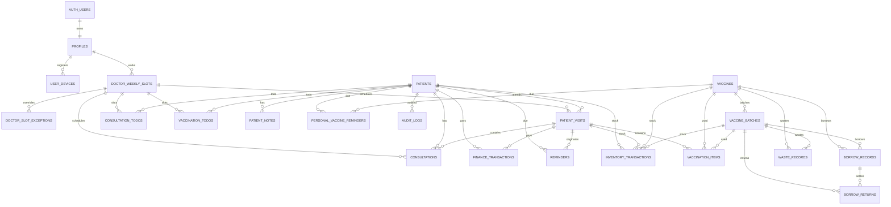

# Data Dictionary

> **Source: user-supplied metadata exports, not a live query.** The 2026-10-20 and 2026-10-21 column exports list 24 public tables and 416 columns; the newer export set also reports primary/foreign/unique/check constraints, indexes, RLS, grants, functions, triggers, and Realtime membership. Project identity, capture environment, and runtime behaviour are unstated. Nullability/defaults are reproduced as supplied. This document does **not** invent column semantics.
>
> **The older Android-repository CSV is stale.** It lists 23 tables and 361 columns and uses camelCase `waste_records` fields. Current migrations/source use snake_case and soft-delete fields. Do not generate desktop models from the old snapshot. Neither column CSV contains a project URL, auth setting, policy, or credential; see [[Audits/Shared-Backend-Connection-Investigation|Shared Backend Connection Investigation]].

> **Snapshot limits.** Some tables have ordinal-position gaps (for example `patients` jumps from 9 to 12), even though the row count equals the reported column count. Those gaps are consistent with dropped columns; they do not prove omitted rows. The newer export now supplies keys, constraints, indexes, policies, table ACLs, and trigger metadata, but it still has **no views, enums, domains, sequences, schema/sequence/column ACLs, runtime test, or migration history**. It is a coherent metadata snapshot, not a certified deployed contract. See [[Audits/Phase-0C-Schema-Export-Review|Phase 0C Schema Export Review]] for the exact counts and drift.

## Table summary

| # | Table | Columns | Purpose |
|---|---|---|---|
| 1 | `profiles` | 16 | Staff profile and role metadata. |
| 2 | `user_devices` | 12 | Staff device registration/push metadata. |
| 3 | `api_write_rate_limits` | 3 | Internal write-rate-limit counters. |
| 4 | `audit_logs` | 17 | Append-only business audit trail. |
| 5 | `patients` | 18 | Patient demographic identity. |
| 6 | `patient_notes` | 13 | Patient notes. |
| 7 | `patient_visits` | 33 | Visit/payment header, receipt and visit-level snapshots. |
| 8 | `consultations` | 21 | Doctor consultation record. |
| 9 | `consultation_todos` | 18 | Consultation follow-up/todo records. |
| 10 | `vaccination_items` | 17 | Vaccine line items for a visit. |
| 11 | `vaccination_todos` | 19 | Vaccination follow-up/todo records. |
| 12 | `reminders` | 24 | Clinical vaccination due reminders. |
| 13 | `personal_vaccine_reminders` | 22 | Personal/non-clinical follow-up reminders. |
| 14 | `vaccines` | 18 | Vaccine catalog. |
| 15 | `vaccine_batches` | 23 | Batch-level stock and expiry. |
| 16 | `inventory_transactions` | 18 | Stock movement ledger. |
| 17 | `waste_records` | 17 | Wastage records. |
| 18 | `borrow_records` | 18 | Borrow/lend records. |
| 19 | `borrow_returns` | 14 | Borrow return records. |
| 20 | `finance_transactions` | 23 | Income/payment transactions. |
| 21 | `expenses` | 18 | Clinic expenses. |
| 22 | `receipt_sequences` | 6 | Per-financial-year receipt number sequence. |
| 23 | `doctor_weekly_slots` | 14 | Recurring doctor availability. |
| 24 | `doctor_slot_exceptions` | 14 | Doctor availability exceptions. |

## Keys, constraints, and indexes

> **Evidence `L`, not a runtime test.** The 2026-10-21 metadata export reports **77 constraints** (24 primary keys, 38 foreign keys, 3 unique, 12 check), **93 indexes** (33 unique, including primary/unique constraints), and all 24 tables with RLS enabled and none forced. The table below condenses those rows; names and `ON DELETE` actions are omitted unless they affect the client contract. The exact definitions are in `docs/Schemas/` and [[Audits/Phase-0C-Schema-Export-Review|Phase 0C §3]].

| Table | Primary key | Reported foreign keys / unique / check constraints | Indexes |
|---|---|---|---:|
| `profiles` | `id` | `id → auth.users` CASCADE; UNIQUE `email`; role-list CHECK | 3 |
| `user_devices` | `id` | `user_id → profiles` CASCADE; two identical UNIQUE FCM indexes | 4 |
| `api_write_rate_limits` | `(user_id, window_started_at)` | none | 1 |
| `audit_logs` | `id` | `patient_id → patients` | 3 |
| `patients` | `id` | UNIQUE `patient_clinic_id`; duplicate unique indexes | 5 |
| `patient_notes` | `id` | `patient_id → patients` CASCADE | 2 |
| `patient_visits` | `id` | `patient_id → patients` CASCADE; `availability_slot_id` SET NULL; unique receipt index | 5 |
| `consultations` | `id` | `patient_id`/`visit_id` CASCADE; `availability_slot_id` SET NULL | 4 |
| `consultation_todos` | `id` | `patient_id`/`doctor_id`/`availability_slot_id`, all SET NULL | 6 |
| `vaccination_items` | `id` | `vaccination_id → patient_visits` CASCADE; `vaccine_id`; `batch_id` | 3 |
| `vaccination_todos` | `id` | `patient_id`/`doctor_id`/`availability_slot_id`, all SET NULL | 6 |
| `reminders` | `id` | `patient_id`/`original_visit_id` CASCADE; duplicate natural UNIQUE key | 4 |
| `personal_vaccine_reminders` | `id` | `patient_id` CASCADE; `vaccine_id` SET NULL; 2 CHECKs | 6 |
| `vaccines` | `id` | none | 2 |
| `vaccine_batches` | `id` | `vaccine_id → vaccines` CASCADE | 2 |
| `inventory_transactions` | `id` | `vaccine_id`/`batch_id`/`patient_id`/`visit_id` | 7 |
| `waste_records` | `id` | `vaccine_id`; `batch_id` | 2 |
| `borrow_records` | `id` | `vaccine_id`; `batch_id` | 3 |
| `borrow_returns` | `id` | `borrow_record_id`/`batch_id` CASCADE; CHECK `quantity > 0` | 4 |
| `finance_transactions` | `id` | `patient_id`; `visit_id` | 4 |
| `expenses` | `id` (text) | 3 CHECKs: category, payment method, amount | 6 |
| `receipt_sequences` | `financial_year` | none | 1 |
| `doctor_weekly_slots` | `id` | `doctor_id → profiles` CASCADE; 3 CHECKs | 5 |
| `doctor_slot_exceptions` | `id` | `doctor_id`/`weekly_slot_id` CASCADE; CHECK type/slot consistency | 5 |

**Drift and contract cautions:**

- **Six reported columns are not reproducible from repository migrations:** `borrow_returns.updated_at`, `doctor_weekly_slots.is_synced`, `doctor_slot_exceptions.is_synced`, and `receipt_sequences.created_at`/`created_by`/`updated_by`. `CREATE TABLE IF NOT EXISTS` masked pre-existing shapes.
- **Android and the database disagree on doctor exceptions.** `DoctorSlotExceptionEntity` sends `start_minute` and `end_minute`; the reported table has neither. A desktop model generated from Android Room would be wrong; do not send those fields until the backend contract changes.
- **Duplicate unique indexes/constraints** exist for `patients`, `reminders`, `profiles`, and `user_devices`. Upsert conflict targets must be reviewed; do not assume a single canonical unique key.
- **All tables are owned by `postgres`, RLS enabled, not forced.** Table grants are broadly permissive on 22 tables. See [[Security/Security-Model|Security Model]] before treating a column-level design as an authorization boundary.

## Reading the tables

- `text` dates are business dates in many tables; do not treat them as typed dates without validation.
- Shared-schema money columns are `numeric` (exact decimal), except `expenses.amount_paise` (`bigint`); Android maps most of them to `Double`. Treat integer paise as the desktop calculation type and convert at the numeric boundary; the risk is client-side floating arithmetic, not a float database column.
- `created_by`/`updated_by` may be display labels rather than UUIDs; do not assume referential integrity.
- `is_deleted`/`deleted_at`/`deleted_by` are soft-delete fields where present; filtering must be consistent across reads and reports.
- `is_synced` is a legacy per-row flag; it is not a substitute for a server acknowledgement or outbox.

## Columns

### `profiles`

Staff profile and role metadata.

| # | Column | PostgreSQL type | Nullable | Default |
|---|---|---|---|---|
| 1 | `id` | uuid | NO | null |
| 2 | `email` | text | NO | null |
| 3 | `display_name` | text | YES | null |
| 4 | `phone_number` | text | YES | null |
| 5 | `role` | text | YES | 'nurse'::text |
| 6 | `is_active` | boolean | YES | true |
| 7 | `employee_id` | text | YES | null |
| 8 | `fcm_token` | text | YES | null |
| 9 | `created_at` | timestamp with time zone | YES | now() |
| 10 | `updated_at` | timestamp with time zone | YES | now() |
| 11 | `last_login` | timestamp with time zone | YES | null |
| 12 | `is_deleted` | boolean | NO | false |
| 13 | `deleted_at` | timestamp with time zone | YES | null |
| 14 | `deleted_by` | uuid | YES | null |
| 15 | `created_by` | text | YES | null |
| 16 | `updated_by` | text | YES | null |

### `user_devices`

Staff device registration/push metadata.

| # | Column | PostgreSQL type | Nullable | Default |
|---|---|---|---|---|
| 1 | `id` | uuid | NO | gen_random_uuid() |
| 2 | `user_id` | uuid | YES | null |
| 3 | `fcm_token` | text | NO | null |
| 4 | `device_name` | text | YES | null |
| 5 | `platform` | text | YES | 'Android'::text |
| 6 | `app_version` | text | YES | null |
| 7 | `is_active` | boolean | YES | true |
| 8 | `last_seen_at` | text | YES | null |
| 9 | `created_at` | text | YES | (now())::text |
| 10 | `updated_at` | timestamp with time zone | NO | now() |
| 11 | `created_by` | uuid | YES | null |
| 12 | `updated_by` | uuid | YES | null |

### `api_write_rate_limits`

Internal write-rate-limit counters.

| # | Column | PostgreSQL type | Nullable | Default |
|---|---|---|---|---|
| 1 | `user_id` | uuid | NO | null |
| 2 | `window_started_at` | timestamp with time zone | NO | null |
| 3 | `request_count` | integer | NO | 0 |

### `audit_logs`

Append-only business audit trail.

| # | Column | PostgreSQL type | Nullable | Default |
|---|---|---|---|---|
| 1 | `id` | uuid | NO | gen_random_uuid() |
| 2 | `timestamp` | text | YES | (now())::text |
| 3 | `user` | text | YES | null |
| 4 | `module` | text | YES | null |
| 5 | `entity_type` | text | YES | null |
| 6 | `entity_id` | text | YES | null |
| 7 | `action` | text | YES | null |
| 8 | `old_value` | text | YES | null |
| 9 | `new_value` | text | YES | null |
| 10 | `remarks` | text | YES | null |
| 11 | `device` | text | YES | null |
| 12 | `patient_id` | uuid | YES | null |
| 13 | `is_synced` | boolean | YES | true |
| 14 | `created_at` | timestamp with time zone | NO | now() |
| 15 | `updated_at` | timestamp with time zone | NO | now() |
| 16 | `created_by` | text | YES | null |
| 17 | `updated_by` | text | YES | null |

### `patients`

Patient demographic identity.

| # | Column | PostgreSQL type | Nullable | Default |
|---|---|---|---|---|
| 1 | `id` | uuid | NO | gen_random_uuid() |
| 2 | `patient_clinic_id` | text | YES | null |
| 3 | `name` | text | NO | null |
| 4 | `phone` | text | YES | null |
| 5 | `alternate_phone` | text | YES | null |
| 6 | `dob` | date | YES | null |
| 7 | `gender` | text | YES | null |
| 8 | `address` | text | YES | null |
| 9 | `registration_date` | timestamp with time zone | YES | now() |
| 12 | `attachments` | jsonb | YES | null |
| 13 | `updated_at` | timestamp with time zone | YES | now() |
| 14 | `is_synced` | boolean | YES | true |
| 15 | `created_at` | timestamp with time zone | NO | now() |
| 16 | `created_by` | text | YES | null |
| 17 | `updated_by` | text | YES | null |
| 18 | `is_deleted` | boolean | NO | false |
| 19 | `deleted_at` | timestamp with time zone | YES | null |
| 20 | `deleted_by` | text | YES | null |

### `patient_notes`

Patient notes.

| # | Column | PostgreSQL type | Nullable | Default |
|---|---|---|---|---|
| 1 | `id` | uuid | NO | gen_random_uuid() |
| 2 | `patient_id` | uuid | YES | null |
| 3 | `content` | text | NO | ''::text |
| 4 | `author` | text | YES | null |
| 5 | `timestamp` | text | YES | (now())::text |
| 6 | `is_synced` | boolean | YES | true |
| 7 | `created_at` | timestamp with time zone | NO | now() |
| 8 | `updated_at` | timestamp with time zone | NO | now() |
| 9 | `created_by` | text | YES | null |
| 10 | `updated_by` | text | YES | null |
| 11 | `is_deleted` | boolean | NO | false |
| 12 | `deleted_at` | timestamp with time zone | YES | null |
| 13 | `deleted_by` | text | YES | null |

### `patient_visits`

Visit/payment header, receipt and visit-level snapshots.

| # | Column | PostgreSQL type | Nullable | Default |
|---|---|---|---|---|
| 1 | `id` | uuid | NO | gen_random_uuid() |
| 2 | `patient_id` | uuid | YES | null |
| 3 | `date_given` | text | NO | (now())::text |
| 4 | `doctor` | text | YES | null |
| 5 | `vaccine_names` | text | YES | null |
| 6 | `vaccine_ids` | text | YES | null |
| 7 | `batch_ids` | text | YES | null |
| 8 | `batch_numbers` | text | YES | null |
| 9 | `materials_used` | text | YES | null |
| 10 | `notes` | text | YES | null |
| 11 | `receipt_number` | text | YES | null |
| 12 | `total_paid` | numeric | YES | 0.0 |
| 13 | `payment_id` | uuid | YES | null |
| 14 | `nxt_vaccine_names` | text | YES | null |
| 15 | `next_due_date` | text | YES | null |
| 16 | `cash_amount` | numeric | YES | 0.0 |
| 17 | `online_amount` | numeric | YES | 0.0 |
| 18 | `with_fees` | boolean | YES | false |
| 19 | `doctors_acc` | boolean | YES | false |
| 20 | `status` | text | YES | 'ACTIVE'::text |
| 21 | `source` | text | YES | 'CLINIC'::text |
| 22 | `visit_type` | text | YES | 'VACCINATION'::text |
| 23 | `inventory_status` | text | YES | 'PENDING'::text |
| 24 | `created_at` | timestamp with time zone | NO | now() |
| 25 | `updated_at` | timestamp with time zone | NO | now() |
| 26 | `is_synced` | boolean | YES | true |
| 27 | `doctor_id` | text | YES | ''::text |
| 28 | `created_by` | text | YES | null |
| 29 | `updated_by` | text | YES | null |
| 30 | `availability_slot_id` | uuid | YES | null |
| 31 | `is_deleted` | boolean | NO | false |
| 32 | `deleted_at` | timestamp with time zone | YES | null |
| 33 | `deleted_by` | text | YES | null |

### `consultations`

Doctor consultation record.

| # | Column | PostgreSQL type | Nullable | Default |
|---|---|---|---|---|
| 1 | `id` | uuid | NO | gen_random_uuid() |
| 2 | `visit_id` | uuid | YES | null |
| 3 | `patient_id` | uuid | YES | null |
| 4 | `doctor_id` | text | YES | null |
| 5 | `doctor_name` | text | YES | null |
| 6 | `date` | text | NO | (now())::text |
| 7 | `amount` | numeric | NO | 0.0 |
| 8 | `cash_amount` | numeric | YES | 0.0 |
| 9 | `online_amount` | numeric | YES | 0.0 |
| 10 | `problem` | text | YES | null |
| 11 | `notes` | text | YES | null |
| 12 | `next_follow_up_date` | text | YES | null |
| 13 | `created_at` | text | YES | (now())::text |
| 14 | `updated_at` | text | YES | (now())::text |
| 15 | `is_synced` | boolean | YES | true |
| 16 | `created_by` | text | YES | null |
| 17 | `updated_by` | text | YES | null |
| 18 | `availability_slot_id` | uuid | YES | null |
| 19 | `is_deleted` | boolean | NO | false |
| 20 | `deleted_at` | timestamp with time zone | YES | null |
| 21 | `deleted_by` | text | YES | null |

### `consultation_todos`

Consultation follow-up/todo records.

| # | Column | PostgreSQL type | Nullable | Default |
|---|---|---|---|---|
| 1 | `id` | uuid | NO | gen_random_uuid() |
| 2 | `patient_id` | uuid | YES | null |
| 3 | `name` | text | NO | null |
| 4 | `mobile` | text | NO | null |
| 5 | `address` | text | NO | ''::text |
| 6 | `todo_date` | date | NO | null |
| 7 | `status` | text | NO | 'PENDING'::text |
| 8 | `created_at` | timestamp with time zone | NO | now() |
| 9 | `updated_at` | timestamp with time zone | NO | now() |
| 10 | `is_synced` | boolean | NO | true |
| 11 | `created_by` | text | YES | null |
| 12 | `updated_by` | text | YES | null |
| 13 | `doctor_id` | uuid | YES | null |
| 14 | `doctor_name` | text | YES | null |
| 15 | `availability_slot_id` | uuid | YES | null |
| 16 | `is_deleted` | boolean | NO | false |
| 17 | `deleted_at` | timestamp with time zone | YES | null |
| 18 | `deleted_by` | text | YES | null |

### `vaccination_items`

Vaccine line items for a visit.

| # | Column | PostgreSQL type | Nullable | Default |
|---|---|---|---|---|
| 1 | `id` | uuid | NO | gen_random_uuid() |
| 2 | `vaccination_id` | uuid | YES | null |
| 3 | `vaccine_id` | uuid | YES | null |
| 4 | `batch_id` | uuid | YES | null |
| 5 | `quantity` | integer | YES | 1 |
| 6 | `mrp` | numeric | YES | 0.0 |
| 7 | `net_rate` | numeric | YES | 0.0 |
| 8 | `expiry_date` | text | YES | null |
| 9 | `vaccine_name` | text | NO | ''::text |
| 10 | `batch_number` | text | NO | ''::text |
| 11 | `created_at` | timestamp with time zone | NO | now() |
| 12 | `updated_at` | timestamp with time zone | NO | now() |
| 13 | `created_by` | text | YES | null |
| 14 | `updated_by` | text | YES | null |
| 15 | `is_deleted` | boolean | NO | false |
| 16 | `deleted_at` | timestamp with time zone | YES | null |
| 17 | `deleted_by` | text | YES | null |

### `vaccination_todos`

Vaccination follow-up/todo records.

| # | Column | PostgreSQL type | Nullable | Default |
|---|---|---|---|---|
| 1 | `id` | uuid | NO | gen_random_uuid() |
| 2 | `patient_id` | uuid | YES | null |
| 3 | `name` | text | NO | null |
| 4 | `mobile` | text | NO | null |
| 5 | `vaccine_names` | text | NO | null |
| 6 | `address` | text | NO | ''::text |
| 7 | `todo_date` | date | NO | null |
| 8 | `status` | text | NO | 'PENDING'::text |
| 9 | `created_at` | timestamp with time zone | NO | now() |
| 10 | `updated_at` | timestamp with time zone | NO | now() |
| 11 | `is_synced` | boolean | NO | true |
| 12 | `created_by` | text | YES | null |
| 13 | `updated_by` | text | YES | null |
| 14 | `doctor_id` | uuid | YES | null |
| 15 | `doctor_name` | text | YES | null |
| 16 | `availability_slot_id` | uuid | YES | null |
| 17 | `is_deleted` | boolean | NO | false |
| 18 | `deleted_at` | timestamp with time zone | YES | null |
| 19 | `deleted_by` | text | YES | null |

### `reminders`

Clinical vaccination due reminders.

| # | Column | PostgreSQL type | Nullable | Default |
|---|---|---|---|---|
| 1 | `id` | uuid | NO | gen_random_uuid() |
| 2 | `patient_id` | uuid | NO | null |
| 3 | `original_visit_id` | uuid | NO | null |
| 4 | `vaccine_name` | text | NO | null |
| 5 | `due_date` | text | NO | null |
| 6 | `status` | text | NO | null |
| 7 | `priority` | text | YES | 'NORMAL'::text |
| 8 | `reminder_enabled` | boolean | YES | true |
| 9 | `category` | text | YES | 'VACCINATION'::text |
| 10 | `type` | text | YES | ''::text |
| 11 | `nxt_vaccine_id` | ARRAY | YES | null |
| 12 | `notes` | text | YES | null |
| 13 | `completion_date` | text | YES | null |
| 14 | `performed_by` | text | YES | null |
| 15 | `dismissal_date` | text | YES | null |
| 16 | `dismissal_reason` | text | YES | null |
| 17 | `created_at` | timestamp with time zone | YES | now() |
| 18 | `updated_at` | timestamp with time zone | YES | now() |
| 19 | `is_synced` | boolean | YES | true |
| 20 | `created_by` | text | YES | null |
| 21 | `updated_by` | text | YES | null |
| 22 | `is_deleted` | boolean | NO | false |
| 23 | `deleted_at` | timestamp with time zone | YES | null |
| 24 | `deleted_by` | text | YES | null |

### `personal_vaccine_reminders`

Personal/non-clinical follow-up reminders.

| # | Column | PostgreSQL type | Nullable | Default |
|---|---|---|---|---|
| 1 | `id` | uuid | NO | gen_random_uuid() |
| 2 | `patient_id` | uuid | YES | null |
| 3 | `vaccine_id` | uuid | YES | null |
| 4 | `vaccine_label` | text | YES | null |
| 5 | `note` | text | YES | null |
| 6 | `advance_received` | boolean | NO | false |
| 7 | `advance_amount` | numeric | YES | null |
| 8 | `advance_date` | date | YES | null |
| 9 | `reminder_date` | date | YES | null |
| 10 | `status` | text | NO | 'PENDING'::text |
| 11 | `created_at` | timestamp with time zone | NO | now() |
| 12 | `updated_at` | timestamp with time zone | NO | now() |
| 13 | `completed_at` | timestamp with time zone | YES | null |
| 14 | `cancelled_at` | timestamp with time zone | YES | null |
| 15 | `is_synced` | boolean | NO | true |
| 16 | `created_by` | text | YES | null |
| 17 | `updated_by` | text | YES | null |
| 18 | `patient_name` | text | NO | null |
| 19 | `patient_phone` | text | NO | null |
| 20 | `is_deleted` | boolean | NO | false |
| 21 | `deleted_at` | timestamp with time zone | YES | null |
| 22 | `deleted_by` | text | YES | null |

### `vaccines`

Vaccine catalog.

| # | Column | PostgreSQL type | Nullable | Default |
|---|---|---|---|---|
| 1 | `id` | uuid | NO | gen_random_uuid() |
| 2 | `type` | text | YES | null |
| 3 | `brand_name` | text | YES | null |
| 4 | `company_name` | text | YES | null |
| 5 | `manufacturer` | text | YES | null |
| 6 | `category` | text | YES | null |
| 7 | `dose_schedule` | text | YES | null |
| 8 | `storage_details` | text | YES | null |
| 9 | `mrp` | numeric | YES | 0.0 |
| 10 | `net_rate` | numeric | YES | 0.0 |
| 11 | `last_updated` | text | YES | (now())::text |
| 12 | `created_at` | timestamp with time zone | NO | now() |
| 13 | `updated_at` | timestamp with time zone | NO | now() |
| 14 | `created_by` | text | YES | null |
| 15 | `updated_by` | text | YES | null |
| 16 | `is_deleted` | boolean | NO | false |
| 17 | `deleted_at` | timestamp with time zone | YES | null |
| 18 | `deleted_by` | text | YES | null |

### `vaccine_batches`

Batch-level stock and expiry.

| # | Column | PostgreSQL type | Nullable | Default |
|---|---|---|---|---|
| 1 | `id` | uuid | NO | gen_random_uuid() |
| 2 | `vaccine_id` | uuid | YES | null |
| 3 | `batch_number` | text | YES | null |
| 4 | `manufacturer` | text | YES | null |
| 5 | `purchase_date` | text | YES | null |
| 6 | `expiry_date` | text | YES | null |
| 7 | `purchase_quantity` | integer | YES | 0 |
| 8 | `remaining_quantity` | integer | YES | 0 |
| 9 | `reserved_quantity` | integer | YES | 0 |
| 10 | `used_quantity` | integer | YES | 0 |
| 11 | `wasted_quantity` | integer | YES | 0 |
| 12 | `borrowed_quantity` | integer | YES | 0 |
| 13 | `supplier` | text | YES | null |
| 14 | `purchase_cost` | numeric | YES | null |
| 15 | `selling_price` | numeric | YES | null |
| 16 | `status` | text | YES | 'ACTIVE'::text |
| 17 | `updated_at` | text | YES | (now())::text |
| 18 | `created_at` | timestamp with time zone | NO | now() |
| 19 | `created_by` | text | YES | null |
| 20 | `updated_by` | text | YES | null |
| 21 | `is_deleted` | boolean | NO | false |
| 22 | `deleted_at` | timestamp with time zone | YES | null |
| 23 | `deleted_by` | text | YES | null |

### `inventory_transactions`

Stock movement ledger.

| # | Column | PostgreSQL type | Nullable | Default |
|---|---|---|---|---|
| 1 | `id` | uuid | NO | gen_random_uuid() |
| 2 | `vaccine_id` | uuid | YES | null |
| 3 | `batch_id` | uuid | YES | null |
| 4 | `patient_id` | uuid | YES | null |
| 5 | `visit_id` | uuid | YES | null |
| 6 | `transaction_type` | text | YES | null |
| 7 | `quantity` | integer | NO | 0 |
| 8 | `previous_quantity` | integer | YES | 0 |
| 9 | `current_quantity` | integer | YES | 0 |
| 10 | `timestamp` | text | YES | (now())::text |
| 11 | `user` | text | YES | null |
| 12 | `notes` | text | YES | null |
| 13 | `is_synced` | boolean | YES | true |
| 14 | `status` | text | YES | 'COMPLETED'::text |
| 15 | `created_at` | timestamp with time zone | NO | now() |
| 16 | `updated_at` | timestamp with time zone | NO | now() |
| 17 | `created_by` | text | YES | null |
| 18 | `updated_by` | text | YES | null |

### `waste_records`

Wastage records.

| # | Column | PostgreSQL type | Nullable | Default |
|---|---|---|---|---|
| 1 | `id` | uuid | NO | gen_random_uuid() |
| 2 | `vaccine_id` | uuid | YES | null |
| 3 | `batch_id` | uuid | YES | null |
| 4 | `brand_name` | text | YES | null |
| 5 | `batch_number` | text | YES | null |
| 6 | `expiry_date` | text | YES | null |
| 7 | `date_wasted` | text | YES | null |
| 8 | `reason` | text | YES | null |
| 9 | `quantity` | integer | YES | null |
| 10 | `updated_at` | text | YES | now() |
| 11 | `is_synced` | boolean | YES | true |
| 12 | `created_at` | timestamp with time zone | NO | now() |
| 13 | `created_by` | text | YES | null |
| 14 | `updated_by` | text | YES | null |
| 15 | `is_deleted` | boolean | NO | false |
| 16 | `deleted_at` | timestamp with time zone | YES | null |
| 17 | `deleted_by` | text | YES | null |

### `borrow_records`

Borrow/lend records.

| # | Column | PostgreSQL type | Nullable | Default |
|---|---|---|---|---|
| 1 | `id` | uuid | NO | gen_random_uuid() |
| 2 | `doctor_name` | text | YES | null |
| 3 | `vaccine_id` | uuid | YES | null |
| 4 | `batch_id` | uuid | YES | null |
| 5 | `borrowed_date` | text | YES | null |
| 6 | `quantity` | integer | YES | 1 |
| 7 | `is_returned` | boolean | YES | false |
| 8 | `returned_date` | text | YES | null |
| 9 | `type` | text | YES | 'BY'::text |
| 10 | `notes` | text | YES | null |
| 11 | `is_synced` | boolean | YES | true |
| 12 | `created_at` | timestamp with time zone | NO | now() |
| 13 | `updated_at` | timestamp with time zone | NO | now() |
| 14 | `created_by` | text | YES | null |
| 15 | `updated_by` | text | YES | null |
| 16 | `is_deleted` | boolean | NO | false |
| 17 | `deleted_at` | timestamp with time zone | YES | null |
| 18 | `deleted_by` | text | YES | null |

### `borrow_returns`

Borrow return records.

| # | Column | PostgreSQL type | Nullable | Default |
|---|---|---|---|---|
| 1 | `id` | uuid | NO | gen_random_uuid() |
| 2 | `borrow_record_id` | uuid | NO | null |
| 3 | `batch_id` | uuid | NO | null |
| 4 | `quantity` | integer | NO | null |
| 5 | `returned_date` | date | NO | null |
| 6 | `notes` | text | YES | null |
| 7 | `created_at` | timestamp with time zone | NO | now() |
| 8 | `is_synced` | boolean | NO | true |
| 9 | `created_by` | text | YES | null |
| 10 | `updated_by` | text | YES | null |
| 11 | `updated_at` | timestamp with time zone | NO | now() |
| 12 | `is_deleted` | boolean | NO | false |
| 13 | `deleted_at` | timestamp with time zone | YES | null |
| 14 | `deleted_by` | text | YES | null |

### `finance_transactions`

Income/payment transactions.

| # | Column | PostgreSQL type | Nullable | Default |
|---|---|---|---|---|
| 1 | `id` | uuid | NO | gen_random_uuid() |
| 2 | `timestamp` | text | YES | (now())::text |
| 3 | `type` | text | YES | null |
| 4 | `category` | text | YES | null |
| 5 | `amount` | numeric | YES | 0.0 |
| 6 | `cash_amount` | numeric | YES | 0.0 |
| 7 | `online_amount` | numeric | YES | 0.0 |
| 8 | `currency` | text | YES | 'INR'::text |
| 9 | `payment_method` | text | YES | null |
| 10 | `patient_id` | uuid | YES | null |
| 11 | `visit_id` | uuid | YES | null |
| 12 | `reference_number` | text | YES | null |
| 13 | `remarks` | text | YES | null |
| 14 | `recorded_by` | text | YES | null |
| 15 | `is_synced` | boolean | YES | true |
| 16 | `created_at` | timestamp with time zone | NO | now() |
| 17 | `updated_at` | timestamp with time zone | NO | now() |
| 18 | `created_by` | text | YES | null |
| 19 | `updated_by` | text | YES | null |
| 20 | `transaction_date` | date | NO | null |
| 21 | `is_deleted` | boolean | NO | false |
| 22 | `deleted_at` | timestamp with time zone | YES | null |
| 23 | `deleted_by` | text | YES | null |

### `expenses`

Clinic expenses.

| # | Column | PostgreSQL type | Nullable | Default |
|---|---|---|---|---|
| 1 | `id` | text | NO | null |
| 2 | `expense_date` | date | NO | null |
| 3 | `category` | text | NO | null |
| 4 | `title` | text | NO | null |
| 5 | `description` | text | YES | null |
| 6 | `amount_paise` | bigint | NO | null |
| 7 | `payment_method` | text | NO | null |
| 8 | `reference_number` | text | YES | null |
| 9 | `attachment_path` | text | YES | null |
| 10 | `is_deleted` | boolean | NO | false |
| 11 | `created_at` | timestamp with time zone | NO | now() |
| 12 | `updated_at` | timestamp with time zone | NO | now() |
| 13 | `created_by` | text | YES | null |
| 14 | `updated_by` | text | YES | null |
| 15 | `is_synced` | boolean | NO | true |
| 16 | `synced_at` | timestamp with time zone | YES | null |
| 17 | `deleted_at` | timestamp with time zone | YES | null |
| 18 | `deleted_by` | text | YES | null |

### `receipt_sequences`

Per-financial-year receipt number sequence.

| # | Column | PostgreSQL type | Nullable | Default |
|---|---|---|---|---|
| 1 | `financial_year` | text | NO | null |
| 2 | `last_number` | integer | NO | 0 |
| 3 | `updated_at` | timestamp with time zone | NO | now() |
| 4 | `created_at` | timestamp with time zone | NO | now() |
| 5 | `created_by` | uuid | YES | null |
| 6 | `updated_by` | uuid | YES | null |

### `doctor_weekly_slots`

Recurring doctor availability.

| # | Column | PostgreSQL type | Nullable | Default |
|---|---|---|---|---|
| 1 | `id` | uuid | NO | gen_random_uuid() |
| 2 | `doctor_id` | uuid | NO | null |
| 3 | `day_of_week` | smallint | NO | null |
| 4 | `start_minute` | smallint | NO | null |
| 5 | `end_minute` | smallint | NO | null |
| 6 | `is_active` | boolean | NO | true |
| 7 | `created_at` | timestamp with time zone | NO | now() |
| 8 | `updated_at` | timestamp with time zone | NO | now() |
| 9 | `created_by` | text | YES | null |
| 10 | `updated_by` | text | YES | null |
| 11 | `is_synced` | boolean | NO | false |
| 12 | `is_deleted` | boolean | NO | false |
| 13 | `deleted_at` | timestamp with time zone | YES | null |
| 14 | `deleted_by` | text | YES | null |

### `doctor_slot_exceptions`

Doctor availability exceptions.

| # | Column | PostgreSQL type | Nullable | Default |
|---|---|---|---|---|
| 1 | `id` | uuid | NO | gen_random_uuid() |
| 2 | `doctor_id` | uuid | NO | null |
| 3 | `exception_date` | date | NO | null |
| 4 | `exception_type` | text | NO | null |
| 5 | `weekly_slot_id` | uuid | YES | null |
| 6 | `reason` | text | YES | null |
| 8 | `created_at` | timestamp with time zone | NO | now() |
| 9 | `updated_at` | timestamp with time zone | NO | now() |
| 10 | `created_by` | text | YES | null |
| 11 | `updated_by` | text | YES | null |
| 12 | `is_synced` | boolean | YES | null |
| 13 | `is_deleted` | boolean | NO | false |
| 14 | `deleted_at` | timestamp with time zone | YES | null |
| 15 | `deleted_by` | text | YES | null |

## Relationships

The 2026-10-21 export reports **38 foreign keys** across the 24 public tables. All entries below are **reported by the export**; none is a live constraint check. A foreign key proves a declared relationship, not that the desktop has permission to traverse it or that the referenced row is readable.

### Core relationship map

`||--o{` means one parent to zero-or-many children. The export does not prove whether each child foreign key is nullable, whether a child row is required for every parent, or whether the relationship is used by the Android/desktop client. Those are application rules, not FK facts.

### Complete reported foreign-key list

| Child table | Child column | Parent table | Parent column | On delete |
|---|---|---|---|---|
| `profiles` | `id` | `auth.users` | `id` | ON DELETE CASCADE |
| `borrow_returns` | `borrow_record_id` | `borrow_records` | `id` | ON DELETE CASCADE |
| `consultation_todos` | `availability_slot_id` | `doctor_weekly_slots` | `id` | ON DELETE SET NULL |
| `consultations` | `availability_slot_id` | `doctor_weekly_slots` | `id` | ON DELETE SET NULL |
| `doctor_slot_exceptions` | `weekly_slot_id` | `doctor_weekly_slots` | `id` | ON DELETE CASCADE |
| `patient_visits` | `availability_slot_id` | `doctor_weekly_slots` | `id` | ON DELETE SET NULL |
| `vaccination_todos` | `availability_slot_id` | `doctor_weekly_slots` | `id` | ON DELETE SET NULL |
| `consultations` | `visit_id` | `patient_visits` | `id` | ON DELETE CASCADE |
| `finance_transactions` | `visit_id` | `patient_visits` | `id` | NO ACTION |
| `inventory_transactions` | `visit_id` | `patient_visits` | `id` | NO ACTION |
| `reminders` | `original_visit_id` | `patient_visits` | `id` | ON DELETE CASCADE |
| `vaccination_items` | `vaccination_id` | `patient_visits` | `id` | ON DELETE CASCADE |
| `audit_logs` | `patient_id` | `patients` | `id` | NO ACTION |
| `consultation_todos` | `patient_id` | `patients` | `id` | ON DELETE SET NULL |
| `consultations` | `patient_id` | `patients` | `id` | ON DELETE CASCADE |
| `finance_transactions` | `patient_id` | `patients` | `id` | NO ACTION |
| `inventory_transactions` | `patient_id` | `patients` | `id` | NO ACTION |
| `patient_notes` | `patient_id` | `patients` | `id` | ON DELETE CASCADE |
| `patient_visits` | `patient_id` | `patients` | `id` | ON DELETE CASCADE |
| `personal_vaccine_reminders` | `patient_id` | `patients` | `id` | ON DELETE CASCADE |
| `reminders` | `patient_id` | `patients` | `id` | ON DELETE CASCADE |
| `vaccination_todos` | `patient_id` | `patients` | `id` | ON DELETE SET NULL |
| `consultation_todos` | `doctor_id` | `profiles` | `id` | ON DELETE SET NULL |
| `doctor_slot_exceptions` | `doctor_id` | `profiles` | `id` | ON DELETE CASCADE |
| `doctor_weekly_slots` | `doctor_id` | `profiles` | `id` | ON DELETE CASCADE |
| `user_devices` | `user_id` | `profiles` | `id` | ON DELETE CASCADE |
| `vaccination_todos` | `doctor_id` | `profiles` | `id` | ON DELETE SET NULL |
| `borrow_records` | `batch_id` | `vaccine_batches` | `id` | NO ACTION |
| `borrow_returns` | `batch_id` | `vaccine_batches` | `id` | ON DELETE CASCADE |
| `inventory_transactions` | `batch_id` | `vaccine_batches` | `id` | ON DELETE CASCADE |
| `vaccination_items` | `batch_id` | `vaccine_batches` | `id` | NO ACTION |
| `waste_records` | `batch_id` | `vaccine_batches` | `id` | NO ACTION |
| `borrow_records` | `vaccine_id` | `vaccines` | `id` | NO ACTION |
| `inventory_transactions` | `vaccine_id` | `vaccines` | `id` | ON DELETE CASCADE |
| `personal_vaccine_reminders` | `vaccine_id` | `vaccines` | `id` | ON DELETE SET NULL |
| `vaccination_items` | `vaccine_id` | `vaccines` | `id` | NO ACTION |
| `vaccine_batches` | `vaccine_id` | `vaccines` | `id` | ON DELETE CASCADE |
| `waste_records` | `vaccine_id` | `vaccines` | `id` | NO ACTION |

### Relationship caveats

- `profiles.id → auth.users.id` crosses from `public` into the `auth` schema. The exporting role's visibility into `auth` is not proven.
- `patient_visits` is the clinical visit. The local Android entity/table name is `visits`; do not confuse it with `patient_visits` in the server export.
- `vaccination_items` links to `patient_visits` through `vaccination_id`, not directly to a patient. Patient identity is reached through the visit.
- `finance_transactions.patient_id`/`visit_id` are reported foreign keys, but historical Android data may contain missing links. Referential integrity is not a substitute for business reconciliation.
- `doctor_slot_exceptions` has a `doctor_id` FK and a `weekly_slot_id` FK. The older inferred “doctor + date” relationship is not a separate FK and is omitted from the 38.
- The absence of a FK is also evidence: local-only tables such as `sync_queue`, `backup_history`, `widget_due_cache`, and `inventory_deductions` do not appear in this server snapshot and must not be created remotely for desktop.
- Local database tables may add indexes or foreign keys that the shared backend does not have. Do not “fix” the shared schema to match Room.

## Known gaps

- The metadata export reports keys, constraints, and indexes, but it is not a runtime certification. There are no views, enums, domains, sequences, schema/sequence/column ACLs, or migration-history rows in the set; Storage bucket settings and runtime role behaviour are not proven.
- Ordinal-position gaps are consistent with dropped columns and do not prove omitted columns. The reported 416-column shape is corroborated by two independent exports, but neither is a complete schema authority.
- `vaccination_items` has `vaccination_id`, not `patient_id`; the supported relationship is `patient_visits → vaccination_items`, then to the patient through the visit.
- `sync_queue`, `widget_due_cache`, `inventory_deductions`, and `backup_history` are local-only Room entities in Android; they are not in this 24-table server snapshot and must not be created remotely for desktop.
- `todo_notification_events` appears in migration SQL but not in the 24-table export; its live status is `[UNKNOWN]`.
- `receipt_sequences` is present with six columns. The reported anon/authenticated DML grants contradict the repository revoke, and the RPC remains anon-executable; do not use direct table access or compute receipts client-side.
- `doctor_slot_exceptions.start_minute`/`end_minute` are absent from the reported table. The Android sync contract is therefore not a safe desktop contract.
- Column-level descriptions are not documented; support/clinical owners must approve semantics before using this as a training document.
- The actual live schema may contain legacy columns/tables not present in either export, and the reported data may change after 2026-10-30.

## Related

[[Database/Database-Architecture|Database Architecture]] · [[Database/Schema-Reconciliation|Schema Reconciliation]] · [[Database/Live-Verification-Queries|Live Verification Queries]] · [[Database/Access-Patterns|Access Patterns]] · [[Audits/Initial-Audit|Initial Audit]] · [[Audits/Shared-Backend-Connection-Investigation|Shared Backend Investigation]] · [[Decisions/ADR-0008-Shared-Supabase-Backend|ADR-0008]]
