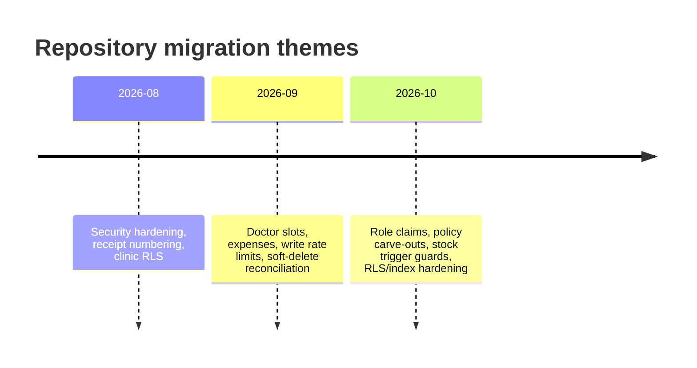

# Database Architecture

> **Hosted state is not verified.** The repository contains migration SQL and two user-supplied CSV column snapshots. Neither is a substitute for inspecting the live Supabase project, its grants, its policies, or its data. Neither CSV is connection configuration; see [[Audits/Shared-Backend-Connection-Investigation|Shared Backend Connection Investigation]].

## Evidence set

| Evidence | What it shows | Confidence |
|---|---|---|
| `supabase/migrations/*.sql` (23 files) | Incremental changes, RLS policies, functions, triggers | `[VERIFIED]` repository |
| Desktop `Supabase Snippet List Public Table Columns.csv` (416 rows, 24 tables) | Newer column snapshot supplied by the user; ordinal gaps suggest omitted columns | `[UNKNOWN]` provenance/time/completeness; treated as evidence, not authority |
| Android `supabase/migrations/Supabase Snippet Full Schema Catalog (Tables, Keys, Indexes).csv` (361 rows, 23 tables) | Older tracked column snapshot; filename claims keys/indexes but it contains only column metadata | `[VERIFIED]` tracked artefact; `[UNKNOWN]` completeness; stale against HEAD |
| Android `app/build.gradle.kts` + `core/di/SupabaseModule.kt` | Actual connection mechanism: build-time URL/key, HTTPS Supabase client | `[VERIFIED]` source; actual values absent |
| Android Knowledge Base `Database Schema`, `Row Level Security`, `Supabase` | Prior source-backed analysis and known gaps | `[INFERRED]` from prior audit |
| Android Room entities/DAOs | Local data model and sync payload shapes | `[VERIFIED]` source |
| Live Supabase project | Actual schema, grants, policies, triggers, data | `[UNKNOWN]` unavailable |

## The most important fact

`[VERIFIED]` There is **no baseline migration** in the repository. Of the 24 tables in the supplied column snapshot, only nine are created by migration SQL:

- `api_write_rate_limits`
- `borrow_returns`
- `consultation_todos`
- `doctor_slot_exceptions`
- `doctor_weekly_slots`
- `expenses`
- `personal_vaccine_reminders`
- `receipt_sequences`
- `vaccination_todos`

The remaining tables are altered by migrations but are not created from zero. A clean `supabase db reset` cannot reproduce the deployed schema from this repository alone. This is a release and disaster-recovery risk, not a documentation inconvenience.

## Shared backend and connection evidence

`[DECISION]` Android and desktop must use the **same existing Supabase project and PostgreSQL schema**. No new project, separate desktop database, duplicate tables, or parallel schema is approved. See [[Decisions/ADR-0008-Shared-Supabase-Backend|ADR-0008]].

`[VERIFIED]` The Android connection path is HTTPS, not direct PostgreSQL:

- `app/build.gradle.kts` injects `BuildConfig.SUPABASE_URL` and `BuildConfig.SUPABASE_ANON_KEY` from `.env.local` or process environment at build time.
- `core/di/SupabaseModule.kt` creates one supabase-kt client with Auth, PostgREST, Functions, Realtime, and Storage.
- Requests carry the signed-in user's JWT; RLS uses `auth.uid()` and `app_metadata.role`.
- No direct JDBC/PostgreSQL driver and no `postgrest.rpc(...)` call were found in Android source.
- The actual project URL and publishable-key value are absent from the clean worktree, so same-project identity is not yet proven.

| CSV comparison | Android repo snapshot | Desktop snapshot | Consequence |
|---|---|---|---|
| Tables / columns | 23 / 361 | 24 / 416 | The desktop snapshot adds `api_write_rate_limits` and 55 column rows, including soft-delete fields. |
| `waste_records` | camelCase columns | snake_case columns | The Android CSV predates `20260919_waste_records_snake_case.sql` and is stale. |
| Connection fields | None | None | Neither file proves the hosted project, auth configuration, grants, RLS, Storage, or Realtime setup. |
| Completeness | Ordinal gaps; no keys/indexes despite filename | Ordinal gaps | Even the newer snapshot is not a complete schema authority. |

The older Android CSV must not be used to generate desktop models or migrations. Use a reviewed live catalog or a verified baseline instead.

## Table groups

The supplied snapshot lists 24 public tables and 416 columns.

| Group | Tables | Purpose |
|---|---|---|
| Identity and accountability | `profiles`, `user_devices`, `api_write_rate_limits`, `audit_logs` | Staff identity, device registration, write throttling, append-only audit |
| Patients | `patients`, `patient_notes`, `patient_visits` | Demographics, notes, visit/payment header |
| Clinical | `consultations`, `consultation_todos`, `vaccination_items`, `vaccination_todos`, `reminders`, `personal_vaccine_reminders` | Consultations, follow-ups, vaccine line items, due reminders |
| Inventory | `vaccines`, `vaccine_batches`, `inventory_transactions`, `waste_records`, `borrow_records`, `borrow_returns` | Catalog, batches, stock ledger, waste, borrow/return |
| Finance | `finance_transactions`, `expenses`, `receipt_sequences` | Income, expenses, server-assigned receipt numbers |
| Scheduling | `doctor_weekly_slots`, `doctor_slot_exceptions` | Recurring availability and exceptions |

### Missing from the supplied snapshot

`[VERIFIED]` `sync_queue`, `widget_due_cache`, `inventory_deductions`, and `backup_history` are Room local-only entities; none appears in either public-table CSV. They should stay local and must not be created remotely for desktop.

`[VERIFIED]` `todo_notification_events` is referenced by migration `20261016_rls_index_and_stock_trigger_hardening.sql` as a table created by a migration not present in the repository. It is absent from both CSVs, so its live status is `[UNKNOWN]`.

`[UNKNOWN]` Same-named public tables could exist outside the evidence set. A read-only live catalog query is required before treating the list as complete.

## RLS and functions

`[VERIFIED]` repository facts:
- 18 `ENABLE ROW LEVEL SECURITY` statements across 13 distinct tables.
- 37 `CREATE POLICY` statements.
- 15 distinct functions, including `is_admin`, `is_active_staff`, `neo_next_receipt_number`, `neo_assign_receipt_number`, `update_batch_stock`, `enforce_write_rate_limit`, and `protect_profile_privileged_fields`.
- 13 `SECURITY DEFINER` declarations.
- 14 `GRANT`/`REVOKE` statements, mostly function execution or locking internal tables.

`[INFERRED]` from migrations:
- Many clinical tables are protected by an active-staff policy, not by per-role scoping. The model is single-clinic, not per-doctor or per-department.
- `profiles` is broadly readable by active staff in at least one baseline policy; the existing security register records this as NSC-001.
- Migration SQL does not include a comprehensive table-level `GRANT` baseline. Hosted privileges may have been created outside the repository; this is NSC-005 and needs live verification.
- `receipt_sequences` and `api_write_rate_limits` are intentionally locked down.
- `audit_logs` is intended to be append-only; the client must not update or delete it.
- `patient-docs` is a private Storage bucket with active-staff object access in the latest storage-policy migration.

## Data types and invariants

| Concern | Observed pattern | Risk |
|---|---|---|
| Dates | Many dates are `text` in business tables (`date`, `date_given`, `expiry_date`, `due_date`) | Lexicographic sorting and timezone ambiguity |
| Money | `double precision`/floating amounts in several tables | Rounding and equality defects |
| Actor labels | `created_by`/`updated_by` are often text display labels, while some audit fields use UUIDs | Accountability ambiguity |
| Soft delete | `is_deleted`, `deleted_at`, `deleted_by` added incrementally | Inconsistent filters and RLS behaviour |
| Sync flags | `is_synced` booleans on many tables | Not a substitute for an outbox or server acknowledgement |
| Receipts | Server sequence keyed by financial year | Must never be computed by the client |
| Stock | Batch counters plus ledger plus trigger | Multiple writers can diverge |

## Migration timeline (high level)

This is a thematic summary, not a complete release history. Exact files are the authority.

## Proposed desktop schema policy

`[PROPOSED]`
1. Verify and document a **baseline schema** that reproduces the existing project, reviewed against the live catalog; do not invent a parallel schema.
2. Keep migrations forward-only, idempotent where safe, and tested through an approved non-destructive verification path. A separate test harness is not approved by default.
3. Generate typed Go/TS models from a reviewed schema snapshot; do not hand-maintain three drifting definitions.
4. Add explicit constraints for money, quantity, due dates, and uniqueness where the domain requires them.
5. Verify RLS with real roles, not only SQL inspection.
6. Add a migration lock and a preflight `schema_version` check in the desktop app.
7. Never let the desktop use a service-role key or bypass RLS for convenience.
8. Treat the local schema as a separate, versioned projection. Do not assume `ALTER TABLE` compatibility.
9. Use the same existing project URL/publishable key as Android; verify a redacted project fingerprint rather than printing credentials.

## Open questions

- What is the actual hosted project identity, and who supplies the approved desktop configuration?
- What non-destructive verification path is approved for schema, grants, RLS, and Storage against the existing project?
- Which environment is authoritative for the baseline: production, staging, or a reconstructed schema?
- Who owns migration review and deployment?
- Are text dates and floating money intentional compatibility constraints, or can the desktop use stronger local types and convert at the boundary?
- What is the retention policy for audit logs and tombstones?
- Does any public table with the same name as a local-only Room table exist live?

## Related

[[Database/Data-Dictionary|Data Dictionary]] · [[Database/Access-Patterns|Access Patterns]] · [[Security/Security-Model|Security Model]] · [[Audits/Initial-Audit|Initial Audit]] · [[Audits/Shared-Backend-Connection-Investigation|Shared Backend Investigation]] · [[Decisions/ADR-0008-Shared-Supabase-Backend|ADR-0008]] · [[Audits/Risk-Register|Risk Register]]
