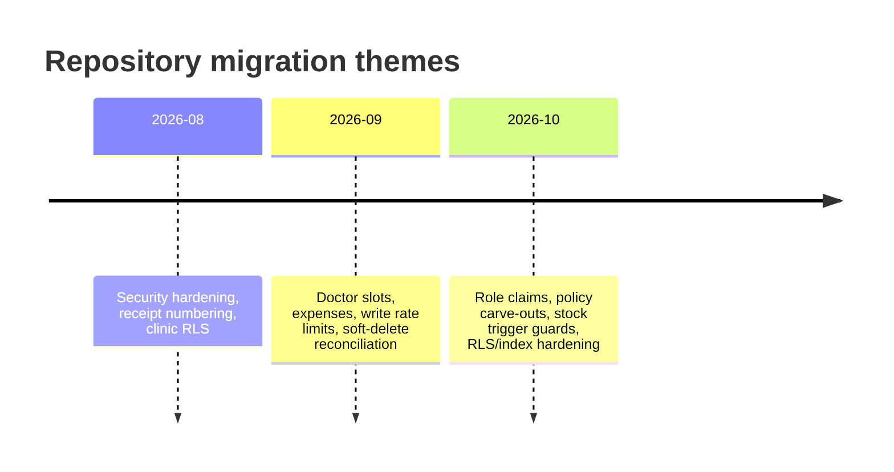

# Database Architecture

> **Hosted state is reported, not certified.** The repository contains migration SQL; `docs/Schemas/` contains 16 user-supplied Supabase metadata exports; and two column snapshots exist. The exports now cover columns, keys, constraints, indexes, RLS, policies, table ACLs, default ACLs, functions, triggers, and Realtime membership. They do not prove project identity, runtime role behaviour, Storage buckets, Auth signup state, or migration history. No SQL was executed for this review; see [[Audits/Phase-0C-Schema-Export-Review|Phase 0C Schema Export Review]] and [[Audits/Shared-Backend-Connection-Investigation|Shared Backend Connection Investigation]].

## Evidence set

| Evidence | What it shows | Confidence |
|---|---|---|
| `supabase/migrations/*.sql` (23 files) | Incremental changes, RLS policies, functions, triggers | `[VERIFIED]` repository |
| Desktop `docs/Schemas/*.csv` (16 exports, 2026-10-20/21) | 24 tables, 416 columns, 77 constraints, 93 indexes, 179 policy rows, 744 table ACL rows, 61 triggers, 21 functions, 30 Realtime rows; 13 function definitions; no Storage buckets | **Reported by export**; no connection/runtime proof; provenance unstated |
| Desktop column CSV (416 rows, 24 tables) | Newer column snapshot supplied by the user; corroborated by the independent 2026-10-21 column export | `[L]` exported evidence; not a schema authority |
| Android `supabase/migrations/Supabase Snippet Full Schema Catalog (Tables, Keys, Indexes).csv` (361 rows, 23 tables) | Older tracked column snapshot; filename claims keys/indexes but it contains only column metadata | `[VERIFIED]` tracked artefact; `[UNKNOWN]` completeness; stale against HEAD |
| Android `app/build.gradle.kts` + `core/di/SupabaseModule.kt` | Actual connection mechanism: build-time URL/key, HTTPS Supabase client | `[VERIFIED]` source; actual values absent |
| Android Knowledge Base `Database Schema`, `Row Level Security`, `Supabase` | Prior source-backed analysis and known gaps | `[INFERRED]` from prior audit |
| Android Room entities/DAOs | Local data model and sync payload shapes | `[VERIFIED]` source |
| Live Supabase project | Runtime behaviour, project identity, Storage buckets, Auth settings, migration history | `[UNKNOWN]` no SQL/HTTP access; exports are metadata only |

## The most important fact

`[VERIFIED]` There is **no baseline migration** in the repository. Of the 24 tables in the supplied column snapshot, only nine are created by migration SQL:

- `api_write_rate_limits`
- `borrow_returns`
- `consultation_todos`
- `doctor_slot_exceptions`
- `doctor_weekly_slots`
- `expenses`
- `personal_vaccine_reminders`
- `receipt_sequences`
- `vaccination_todos`

The remaining 15 tables are altered and policy-managed by migrations but are not created from zero. They are present in both CSV snapshots; absence from creation DDL is not evidence they are absent from production. A clean `supabase db reset` still cannot reproduce the deployed schema from this repository alone. The 2026-10-21 export adds six live-only columns and reports `todo_notification_events` absent, so the repository is not a clean baseline even for tables it appears to create. This is a release and disaster-recovery risk, not a documentation inconvenience.

The 55-row CSV difference is fully explained by migration-visible changes: 15 tables × 3 soft-delete columns = 45; `doctor_slot_exceptions` and `expenses` × 2 additional soft-delete columns = 4; `waste_records` 8 renames plus 3 additions = +3 net; `api_write_rate_limits` = 3. No shared table shows a type/nullability/default difference. See [[Database/Schema-Reconciliation|Schema Reconciliation]].

### What the Phase 0C export establishes

`[REPORTED]`
- 24 public tables, 416 columns, 77 constraints (24 PK/38 FK/3 UNIQUE/12 CHECK), 93 indexes (33 unique).
- All 24 tables owned by `postgres`, RLS enabled, `rls_forced = false`; 179 policy rows, 61 triggers, 21 functions, 744 table ACL rows.
- 22 tables have full `anon`/`authenticated`/`service_role`/`postgres` table privileges; `receipt_sequences` has four DML privileges for anon/auth; `api_write_rate_limits` has none.
- 13 tables retain `{public}` policies; **ten pass for `anon`** through `get_my_role()`'s `'nurse'` fallback. `reminders` allows any authenticated user all operations (`true`/`true`).
- All 21 functions are anon-executable; `get_my_role()` and `handle_new_user()` are `SECURITY DEFINER` without `search_path`.
- **No migration contains a table-level `GRANT`.** Seven tables created by migrations rely on the platform default ACLs, which are not October 30-ready.
- `inventory_transactions` has two stock triggers and the old `update_batch_stock()` body. The fix migration is not applied and is not safely deployable as written.

`[NOT ESTABLISHED]` Runtime authorization, project identity, public signup/trigger state, Storage bucket privacy, Realtime RLS, migration history, sequence/schema ACLs, or the effect of the 2026-10-30 platform change. See [[Audits/Phase-0C-Schema-Export-Review|Phase 0C]] for the full matrix.

## Shared backend and connection evidence

`[DECISION]` Android and desktop must use the **same existing Supabase project and PostgreSQL schema**. No new project, separate remote PostgreSQL database, duplicate remote tables, or parallel remote schema is approved. Local SQLite is a working copy, not a second backend. See [[Decisions/ADR-0008-Shared-Supabase-Backend|ADR-0008]].

`[VERIFIED]` The Android connection path is HTTPS, not direct PostgreSQL:

- `app/build.gradle.kts` injects `BuildConfig.SUPABASE_URL` and `BuildConfig.SUPABASE_ANON_KEY` from `.env.local` or process environment at build time.
- `core/di/SupabaseModule.kt` creates one supabase-kt client with Auth, PostgREST, Functions, Realtime, and Storage.
- Requests carry the signed-in user's JWT. Migration intent uses `auth.uid()` and `app_metadata.role`, but the export shows legacy policies still authorize through `profiles.role`/`get_my_role()`; the role source is split.
- No direct JDBC/PostgreSQL driver and no `postgrest.rpc(...)` call were found in Android source.
- The actual project URL and publishable-key value are absent from the clean worktree, so same-project identity is not yet proven.

| CSV comparison | Android repo snapshot | Desktop snapshot | Consequence |
|---|---|---|---|
| Tables / columns | 23 / 361 | 24 / 416 | The desktop snapshot adds `api_write_rate_limits` and 55 column rows, including soft-delete fields. |
| `waste_records` | camelCase columns | snake_case columns | The Android CSV predates `20260919_waste_records_snake_case.sql` and is stale. |
| Connection fields | None | None | Neither file proves the hosted project, auth configuration, grants, RLS, Storage, or Realtime setup. |
| Completeness | Ordinal gaps; no keys/indexes despite filename | Ordinal gaps; column-only CSV | Ordinal gaps can reflect dropped columns and are not proof of omitted rows. The separate 2026-10-21 metadata exports add keys/indexes/policies, but neither column CSV is a schema authority and no export is runtime-certified. |

`[INFERRED, high]` The Android snapshot is bracketed between the `20260911` slot migration and the `20260919` waste/soft-delete changes: it still has camelCase waste fields and `doctor_slot_exceptions.is_deleted` without `deleted_at`/`deleted_by`. The desktop snapshot is after `20260929`, because it has the full soft-delete set and `api_write_rate_limits`. This chronology explains the counts; it does not prove either snapshot came from production.

The older Android CSV must not be used to generate desktop models or migrations. Use a reviewed live catalog or a verified baseline instead.

## Table groups

The supplied snapshot lists 24 public tables and 416 columns.

| Group | Tables | Purpose |
|---|---|---|
| Identity and accountability | `profiles`, `user_devices`, `api_write_rate_limits`, `audit_logs` | Staff identity, device registration, write throttling, append-only audit |
| Patients | `patients`, `patient_notes`, `patient_visits` | Demographics, notes, visit/payment header |
| Clinical | `consultations`, `consultation_todos`, `vaccination_items`, `vaccination_todos`, `reminders`, `personal_vaccine_reminders` | Consultations, follow-ups, vaccine line items, due reminders |
| Inventory | `vaccines`, `vaccine_batches`, `inventory_transactions`, `waste_records`, `borrow_records`, `borrow_returns` | Catalog, batches, stock ledger, waste, borrow/return |
| Finance | `finance_transactions`, `expenses`, `receipt_sequences` | Income, expenses, server-assigned receipt numbers |
| Scheduling | `doctor_weekly_slots`, `doctor_slot_exceptions` | Recurring availability and exceptions |

### Missing from the supplied snapshot

`[VERIFIED]` `sync_queue`, `widget_due_cache`, `inventory_deductions`, and `backup_history` are Room local-only entities; none appears in either public-table CSV. They should stay local and must not be created remotely for desktop.

`[VERIFIED]` `todo_notification_events` is referenced by migration `20261016_rls_index_and_stock_trigger_hardening.sql` as a table created by a migration not present in the repository. It is absent from both column CSVs and the 24-table relation export, so its live status is `[UNKNOWN]`.

`[UNKNOWN]` Same-named public tables could exist outside the evidence set. A read-only live catalog query is required before treating the list as complete. The export reports no views, enums, domains, or sequences.

## RLS, grants, and functions

`[VERIFIED]` repository intent:
- 18 literal `ENABLE ROW LEVEL SECURITY` statements cover 13 named tables; policy loops enable RLS on additional tables. The union is 25 named public tables: the 24 export tables plus conditional `todo_notification_events`.
- 56 `CREATE POLICY` occurrences: 47 literal statements and 9 loop templates, with repeated drop/recreate history. The deployed policy count cannot be derived from static text alone.
- 15 distinct functions, including `is_admin`, `is_active_staff`, `neo_next_receipt_number`, `neo_assign_receipt_number`, `update_batch_stock`, `enforce_write_rate_limit`, and `protect_profile_privileged_fields`.
- 13 `SECURITY DEFINER` declarations.
- 14 `GRANT`/`REVOKE` statements, mostly function execution or locking internal tables. **No migration contains a table-level `GRANT`.**

`[REPORTED]` exported state — Phase 0C:
- All 24 public tables have RLS enabled and **none is forced**; all are owned by `postgres`. There are 179 policy rows (178 public + one `storage.objects`) across 22 public tables.
- 13 tables retain `{public}` policies. Ten of them pass for `anon` because `get_my_role()` returns `COALESCE(role, 'nurse')` and `auth.uid()` is null: `patients`, `patient_visits`, `patient_notes`, `consultations`, `vaccination_items`, `vaccines`, `vaccine_batches`, `inventory_transactions`, `waste_records`, `borrow_records`.
- `reminders` has an `{authenticated}` `ALL` policy with `USING (true)` and `WITH CHECK (true)`; any authenticated account can read/write all reminders.
- `audit_logs` has a `{public}` INSERT policy requiring only `auth.uid() IS NOT NULL`; any authenticated user can forge entries.
- 744 table ACL rows: 22 tables grant all eight privileges to `anon`/`authenticated`/`service_role`/`postgres`; `receipt_sequences` grants four DML privileges to anon/auth; `api_write_rate_limits` grants none to anon/auth.
- All 21 functions are executable by `anon`, `authenticated`, and `service_role`. This includes `neo_next_receipt_number()` and `recalculate_all_stocks()`. `get_my_role()` and `handle_new_user()` are `SECURITY DEFINER` without `search_path`.
- Default ACLs still grant future `public` tables `arwdDxtm`, functions `X`, and sequences `rwU` to anon/auth/service_role. `REVOKE ... FROM public` in migrations does not remove these explicit grants.

`[INFERRED]` from migrations and exports:
- Many clinical tables are protected by an active-staff policy, not per-role scoping. The model is single-clinic, not per-doctor or per-department.
- `profiles` is broadly readable by active staff in at least one baseline policy; the existing security register records this as NSC-001.
- Migration SQL lacks a comprehensive table-level `GRANT` baseline. The export confirms hosted privileges were broader than repository SQL; this is NSC-005.
- `receipt_sequences` and `api_write_rate_limits` were intended to be locked down. Live ACLs contradict that for `receipt_sequences`; no policy means direct access is RLS-denied, but the anon-executable receipt function remains a path.
- `audit_logs` is intended to be append-only; update/delete are denied, but the insert predicate is too broad.
- `patient-docs` is intended to be a private Storage bucket with active-staff object access in the latest storage-policy migration. The export contains no bucket rows, so privacy is unverified.

**Architectural conclusion:** table `GRANT`, RLS, and function `EXECUTE` are three independent gates. The current snapshot shows the first and third broadly open and the second bypassable for ten tables. Removing only one gate does not certify the others.

## Data types and invariants

| Concern | Observed pattern | Risk |
|---|---|---|
| Dates | Many dates are `text` in business tables (`date`, `date_given`, `expiry_date`, `due_date`) | Lexicographic sorting and timezone ambiguity |
| Money | Shared-schema amounts are `numeric` (exact decimal), except `expenses.amount_paise` (`bigint`); Android maps most to `Double` | Client-side floating arithmetic and lossy boundary conversion can still cause rounding/equality defects |
| Actor labels | `created_by`/`updated_by` are often text display labels, while some audit fields use UUIDs | Accountability ambiguity |
| Soft delete | `is_deleted`, `deleted_at`, `deleted_by` added incrementally | Inconsistent filters and RLS behaviour |
| Sync flags | `is_synced` booleans on many tables | Not a substitute for an outbox or server acknowledgement |
| Receipts | Server sequence keyed by financial year | Must never be computed by the client |
| Stock | Batch counters plus ledger plus trigger | Multiple writers can diverge |

## Migration timeline (high level)

This is a thematic summary, not a complete release history. Exact files are the authority.

## Migration convention corrections

The Phase 0C export disproves several assumptions that the repository's migration style relies on. These are review findings, not executed changes.

1. **Grant explicitly for every new table.** Do not rely on platform default ACLs. A reviewed migration should grant the minimum verbs to `authenticated` (and the intended server path to `service_role`) and should intentionally grant nothing to `anon`. The seven business tables created without grants are not Oct 30-ready.
2. **`REVOKE ... FROM public` is not enough.** `anon` and `authenticated` have explicit default grants, and `PUBLIC` is a different grantee. Revoke from each role whose access is being removed, or remove the default ACL, then verify with `has_table_privilege` and `has_function_privilege`.
3. **Do not rely on `CREATE TABLE IF NOT EXISTS`.** It masked six pre-existing columns and lets a migration pass against a shape it did not create. A reproducible baseline needs the actual columns/constraints, plus an explicit drift check.
4. **Trigger guards must target exact names.** `20261017` counts all other non-internal triggers on `inventory_transactions`, including `neo_stamp_accountability`, `set_updated_at`, and the rate-limit trigger, so its guard raises before it can remove the legacy stock trigger. Drop the named legacy trigger, install one corrected function/trigger, and assert exactly one **stock** trigger.
5. **Harden every `SECURITY DEFINER` function.** Pin `search_path`, revoke execution from `PUBLIC`/`anon`/`authenticated`, grant only the intended role/RPC, and verify the owner. `get_my_role()` and `handle_new_user()` fail this today.
6. **Retire policies explicitly.** Adding an active-staff policy does not drop the legacy `{public}` policy. Migration review must name the policies being dropped, the final policy set, and the role/command each covers. A permissive `true` policy requires a written reason and a negative test.
7. **Choose one canonical unique target.** Duplicate unique indexes/constraints on `patients`, `reminders`, `profiles`, and `user_devices` make upsert conflict targets ambiguous.
8. **Keep migration history truthful.** Hand-applied functions and missing table migrations are proven. No production-only DDL should remain outside the repository, and the migration ledger must be reconciled before relying on "applied" status.

## Proposed desktop schema policy

`[PROPOSED]`
1. Verify and document a **baseline schema** that reproduces the existing project, reviewed against the live catalog; do not invent a parallel schema.
2. Keep migrations forward-only, idempotent where safe, and tested through an approved non-destructive verification path. A separate test harness is not approved by default.
3. Generate typed Go/TS models from a reviewed schema snapshot; do not hand-maintain three drifting definitions.
4. Add explicit constraints for money, quantity, due dates, and uniqueness where the domain requires them.
5. Verify RLS **and** table/function grants with real roles, including `anon` and a non-staff account, not only SQL inspection.
6. Add explicit least-privilege grants to every new table/function and re-verify after the 2026-10-30 Data API change.
7. Add a migration lock and a preflight `schema_version` check in the desktop app.
8. Never let the desktop use a service-role key or bypass RLS for convenience.
9. Treat the local schema as a separate, versioned physical projection. Remote-facing names, columns, keys, timestamps, and soft-delete fields must follow the shared ADR-0008 contract; local-only tables and mapping are allowed. Do not assume `ALTER TABLE` compatibility.
10. Use the same existing project URL/publishable key as Android; verify a redacted project fingerprint rather than printing credentials.

## Open questions

- What is the actual hosted project identity, and who supplies the approved desktop configuration?
- What non-destructive verification path is approved for schema, grants, RLS, and Storage against the existing project?
- Which environment is authoritative for the baseline: production, staging, or a reconstructed schema?
- Who owns migration review and deployment?
- Are text dates and the Android `Double` money mapping intentional compatibility constraints, or can the desktop use stronger local types and convert at the numeric boundary?
- The export shows trigger mode with **two** stock triggers. Who owns removing the duplicate, correcting the function, and reconciling existing batch quantities? Inventory writes remain disabled until then.
- Who owns remediation of the anon/legacy-policy path, and when will it be verified against the live API?
- Will the project's broad default ACLs survive 2026-10-30, and who re-exports them afterward?
- Should `doctor_slot_exceptions.start_minute`/`end_minute` be added, or should Android/desktop stop sending them?
- What is the retention policy for audit logs and any approved deletion records?
- Does any public table with the same name as a local-only Room table exist live?

## Related

[[Database/Data-Dictionary|Data Dictionary]] · [[Database/Schema-Reconciliation|Schema Reconciliation]] · [[Audits/Phase-0C-Schema-Export-Review|Phase 0C Schema Export Review]] · [[Database/Live-Verification-Queries|Live Verification Queries]] · [[Database/Access-Patterns|Access Patterns]] · [[Security/Security-Model|Security Model]] · [[Audits/Initial-Audit|Initial Audit]] · [[Audits/Shared-Backend-Connection-Investigation|Shared Backend Investigation]] · [[Decisions/ADR-0008-Shared-Supabase-Backend|ADR-0008]] · [[Audits/Risk-Register|Risk Register]]
