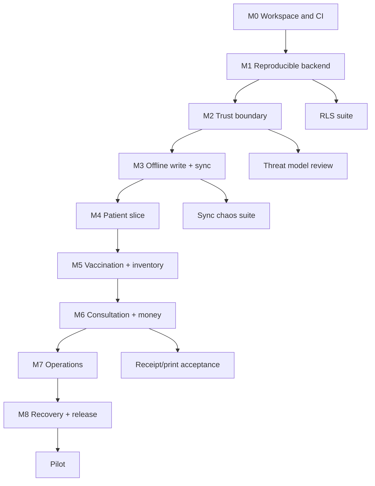

# Dependencies and Milestones

> **No dates.** Milestones are evidence gates. A milestone is complete only when its exit evidence is attached.

## Dependency graph

## Milestones

| ID | Milestone | Exit evidence | Depends on |
|---|---|---|---|
| M0 | Workspace and CI | Clean clone builds; lint/test/docs checks required | None |
| M1 | Reproducible backend | Baseline reset; real grants/policies captured; RLS suite | M0 |
| M2 | Trust boundary | Auth/keychain/IPC/local DB/log redaction tests | M1 |
| M3 | Offline write + sync | Outbox/group/idempotency/replay/deletion-reconciliation tests | M2 |
| M4 | Patient slice | Registration/search/detail/merge/audit offline tests | M3 |
| M5 | Vaccination + inventory | Transaction, stock, due date, payment, receipt link tests | M4 |
| M6 | Consultation + money | Payment split, expense, receipt print, reconciliation tests | M5 |
| M7 | Operations | Waste, borrow, reminders, notifications, reports, audit | M5/M6 |
| M8 | Recovery + release | Backup restore, signed update, rollback, release checklist | M6/M7 |
| Pilot | Controlled clinic pilot | Signed acceptance, training, support, rollback plan | M8 |

## Critical path

M0 → M1 → M2 → M3 → M4 → M5 → M6 → M7 → M8 → Pilot.

M7 can run partly in parallel with M6 only where it does not touch shared stock/payment invariants, but M8 cannot start until both M6 and M7 exit criteria are met.

## External dependencies

| Dependency | Needed for | Status |
|---|---|---|
| Approved shared-backend verification path (existing project) | RLS, functions, sync contracts | Not available; no new project or remote database approved |
| Live schema/grants/policies export | Baseline and security verification | Not available |
| Signing certificate(s) | Release/update | Not available |
| Target OS test machines | Packaging/printing/accessibility | Not available |
| Clinic acceptance owner | Workflow and print/report approval | Not identified |
| Privacy/retention decision | Local storage and backup | Not approved |

## Dependency rules

- No feature work on an unreproducible schema.
- No PHI storage before encryption/key management is approved.
- No sync feature without an idempotency/replay test.
- No payments/receipts without server-side receipt and reconciliation tests.
- No pilot without a restore drill and rollback build.

## Related

[[Roadmap/Desktop-Roadmap|Desktop Roadmap]] · [[Roadmap/Phase-1-Implementation-Plan|Phase 1 Implementation Plan]] · [[Audits/Risk-Register|Risk Register]] · [[Audits/Shared-Backend-Connection-Investigation|Shared Backend Investigation]] · [[Decisions/ADR-0008-Shared-Supabase-Backend|ADR-0008]]
